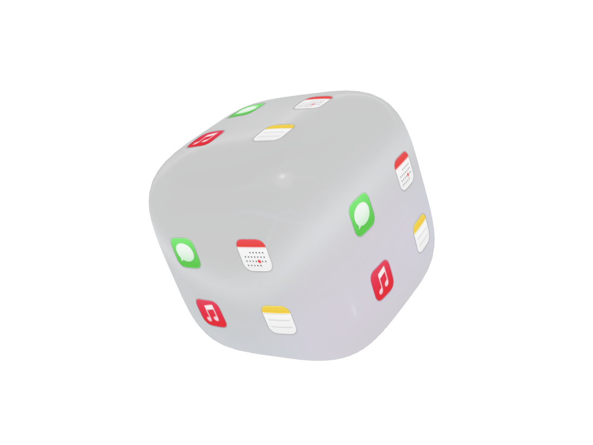
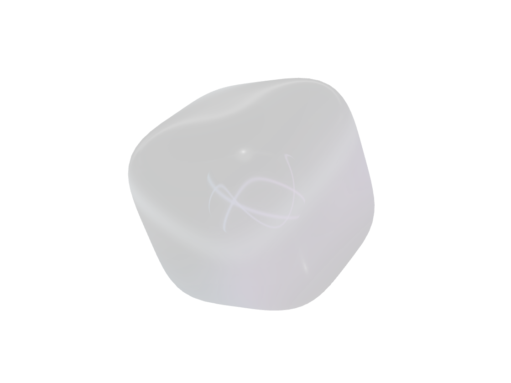
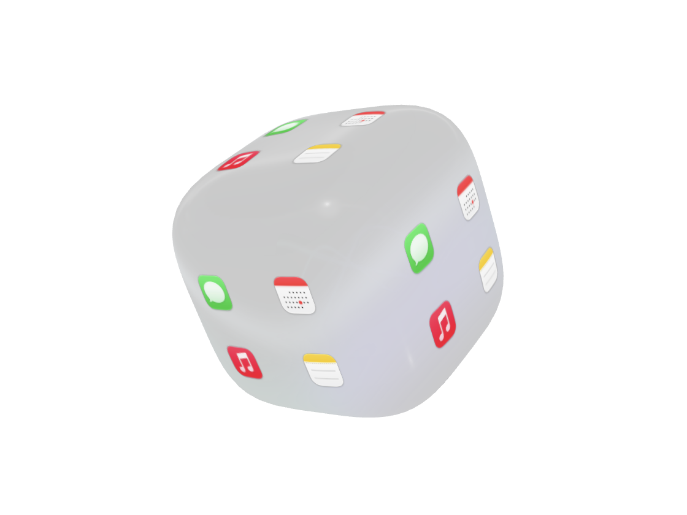
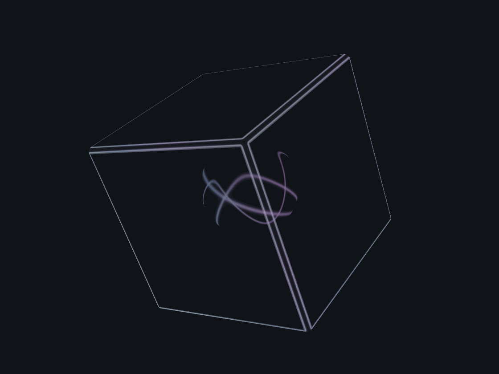
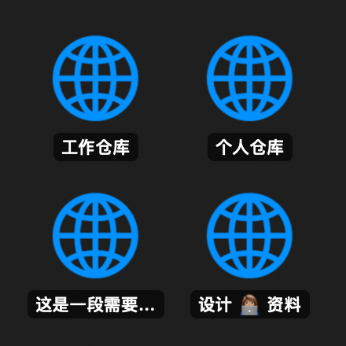

<p align="center">
  
</p>

<h1 align="center">T-Cube</h1>

<p align="center">
  <strong>悬浮在桌面上的通透 3D 玻璃启动器</strong><br>
  将常用 App、文件夹、文件、网页链接与系统控制收纳进轻盈圆润的立方体中。<br>
  滚动旋转、悬停探视、轻点即刻启动。
</p>

<p align="center">
  <a href="https://github.com/gd0306/t-cube/releases/latest"></a>
  <a href="https://developer.apple.com/macos/"></a>
  <a href="https://www.microsoft.com/windows/"></a>
  <a href="https://developer.apple.com/augmented-reality/realitykit/"></a>
  <a href="LICENSE"></a>
  <a href="https://github.com/gd0306/t-cube/stargazers"></a>
</p>

<p align="center">
  <a href="README.md">English</a> · <strong>简体中文</strong>
</p>

---

## 下载安装包

正式发布的稳定版本安装包如下：

| 平台 | 版本 | 安装包文件 | 适配架构 | 说明与运行要求 |
| :--- | :--- | :--- | :--- | :--- |
| **macOS** | `0.22.3` | [T-Cube-0.22.3-macos-arm64.dmg](https://github.com/gd0306/t-cube/releases/download/v0.22.3/T-Cube-0.22.3-macos-arm64.dmg) | Apple Silicon (arm64) | 需要 macOS 15+ · 采用本地 ad-hoc 签名 |
| **Windows** | `0.22.3` | [T-Cube-0.22.3-windows-x64-setup.exe](https://github.com/gd0306/t-cube/releases/download/v0.22.3/T-Cube-0.22.3-windows-x64-setup.exe) | Windows x64 | Windows 10 (22H2) / 11 · 自带完整运行时 |

> [!NOTE]
> - 查看完整发布说明与 SHA-256 校验和：[GitHub Releases](https://github.com/gd0306/t-cube/releases/tag/v0.22.3)。
> - Windows 安装包已整合所需环境，无需单独配置 Node.js。
> - 更新版本前请先正常退出当前运行的应用，原快捷入口与外观配置会自动保留。

---

## 效果预览

通透轻盈的玻璃材质，让桌面背景自然透出；鼠标移入即刻唤醒，应用图标沿曲面优雅展示。

<p align="center">
  
</p>

<table>
  <tr>
    <td align="center">
      <strong>安静的静置状态</strong><br>
      
    </td>
    <td align="center">
      <strong>极光流体材质</strong><br>
      
    </td>
  </tr>
</table>

<details>
<summary><strong>查看空闲自转与悬停响应动画</strong></summary>
<p align="center">
  
</p>
</details>

*以上预览均来自应用的原生渲染并放大展示细节，采用统一的深石墨色背景、相机角度与画面尺寸。*

---

## 核心功能

### 🧊 3D 拟真质感与物理动效
- **通透玻璃与史莱姆材质**：圆角曲面与柔和反光。在 macOS 26+ 上自动启用原生 Clear Liquid Glass（早期支持系统自动回退为磨砂玻璃）。也可随时切换为**史莱姆（Slime）**弹性果冻材质，随鼠标轻微形变牵引并弹润回弹，而表面图标始终稳定清晰。
- **平滑自如的空闲漫游**：静置时以优美平缓的轨迹变换姿态；鼠标移入瞬间静止并显现图标，移出平滑恢复。支持在「外观 → 动态旋转」中关闭，系统开启「减少动态效果」时自动暂停。
- **平滑悬停放大**：鼠标进入自动平滑放大（支持在 1.1×～4.0× 自由调节），移出即恢复静置尺寸。
- **丰富的主题与流动光效**：提供 9 款精心调配的预设主题、自定义双色渐变玻璃，并支持 10 秒／20 秒自动主题轮换（轮换过渡时间约 0.4 秒，顺畅无闪烁）。

### ⚡ 六面多功能快捷启动器
- **24 个快捷槽位**：6 个面，每面容纳 4 个独立入口。空位保持通透留白，点击感应区域与曲面图标精密对齐。
- **多样化入口类型**：支持本地应用程序（App）、文件夹、独立文件（以系统默认应用打开）、HTTP/HTTPS 网页（以默认浏览器打开）以及 macOS 系统设置页面。
- **网页标题实时绘制**：网页入口可直接在图标下方呈现自定义网页标题（长标题单行省略，悬停查看完整标题），完全本地绘制，无需额外请求网络 Favicon。
- **双重打开模式**：支持“点击面展开 4 图标面板后再挑选”，或直接在立方体表面“点击图标直接启动”。

<p align="center">
  
</p>

### 🖥️ 桌面人机工程与硬件级显示控制
- **贴边自动收起**：当立方体靠近屏幕左右外侧边缘（约 32 像素内），鼠标离开约 0.8 秒后自动收缩为 10×56 的高通透微光玻璃条；鼠标移入即可恢复，不改变已保存的停靠坐标。macOS 使用约 0.36 秒的水滴吸附和约 0.46 秒的柔和弹出，支持中途反向；开启「减少动态效果」时不播放位移动画。[查看原生动效预览](docs/images/mac-edge-dock.gif)。
- **全屏智能避让**：所在屏幕运行全屏应用程序时自动隐藏，并完全暂停 3D 渲染，消除背景能耗。
- **屏幕快捷放置**：通过状态栏菜单或「外观 → 快捷位置」一键将立方体精准吸附到所在屏幕的四角或正中央，自动避让 Dock、菜单栏和任务栏区域。
- **macOS 显示器独立亮度控制**：点击菜单栏立方体图标即可独立调节每块屏幕的实际亮度。原生支持 Apple 内建屏幕及通过 Apple Silicon DDC/CI 硬件协议控制外接显示器背光。不需要辅助功能、屏幕录制等额外高风险权限，杜绝软件遮罩蒙层。
- **显示器输入源切换（macOS / Windows）**：源码构建自动检测已连接的显示器，按屏幕分别保存 Type-C／HDMI 映射，不再套用型号预设或猜测端口代码，已有映射保留。身份缺失、存在歧义或无法读码时禁用切换。在 macOS 对应屏幕的「设置…」内或 Windows 输入源面板打开「如何获取输入代码」，可查看实体菜单选端口 → 活动主机刷新读码 → 分别记录十进制代码 → 保存 → 验证的具体步骤。macOS 外接输入控制需要 Apple Silicon 和可用的 DDC/CI 连接；检测到屏幕不等于硬件已验证兼容。切换中禁用，仅回读确认后高亮，无后台轮询。[实现与限制](docs/verification/2026-11-07-display-input-discovery.md)。

### 📋 高效生产力：本地剪贴板与常用模板
- **纯内存会话级剪贴板**：文字与图片历史仅保存在当前运行内存中，退出应用立即彻底销毁，绝不落盘、不进备份、不联网上传。
  - **文本历史**：上限 100 条（单条 64 KiB，总计 2 MiB 限制）。支持多选、按顺序合并、批量清理首尾空格、压缩连续空行，预览无误后复制或粘贴。
  - **图片历史**：保留最近 10 张图片（单张 8 MiB PNG，总计 32 MiB，最高支持 1600 万像素），提供安全缩略图与自适应预览。
- **常用内容库与动态模板**：通过菜单栏／托盘或全局快捷键（macOS `⌘⇧Space`，Windows `Ctrl+Shift+Space`）调出。支持分组管理与常用收藏。在内容中启用「作为模板使用」并嵌入 `{{客户姓名}}` 等动态占位符，一处填入即可自动完成全文变量替换与预览。
- **焦点感知自动粘贴**：获得系统辅助功能授权后，可一键激活并自动粘贴至唤出前的工作窗口。

### ⚙️ 极佳性能与低功耗架构
- **静置低功耗模式**：立方体静置时自动暂停 3D 渲染管线与光效循环（macOS 默认开启），大幅节省能耗。
- **纹理按需复用**：未更改的图标纹理跨刷新复用，空白面不分配多余图集显存，Windows 应用选择器对图标缓存进行严格上限保护。
- **模块化设置界面**：外观、桌面与性能、入口分组、配置备份与生命周期分区管理，操作即时保存生效。
- **轻量版本更新提醒**：支持匿名每 6 小时检查 GitHub Releases 稳定版本（默认关闭，需用户主动开启），提供 1 分钟防刷冷却，一键跳转发布页。

---

## 快捷操作速查

| 操作手势 | 触发交互与效果 |
| :--- | :--- |
| **鼠标悬停 / 移出** | 显示 / 隐藏表面图标；暂停 / 恢复空闲漫游旋转 |
| **触控板双指滑动** | 水平 / 垂直旋转立方体（松手即停，不强制对齐角度） |
| **鼠标滚轮 / Shift + 滚轮** | 垂直 / 水平旋转 |
| **鼠标左键拖动** | 移动立方体在屏幕上的悬浮位置并即刻保存 |
| **鼠标右键拖动** | 自由 3D 旋转视角；松开右键即保留当前角度 |
| **在立方体上方按住 `Ctrl`** | 临时恢复为原始静置尺寸 |
| **`Ctrl` + 鼠标左键拖动** | 以原始静置尺寸拖动移动（拖拽中途松开 `Ctrl` 也不会突变） |
| **点击展开面板外部 / `Esc`** | 关闭已展开的 4 图标面板 |
| **右键单击 / 状态栏图标** | 打开设置面板 |

---

## 快速配置上手

首次启动应用时会自动打开设置窗口，后续也可通过右键单击立方体或点击状态栏图标进入：

1. **配置快捷入口**：在「立方体入口」中为各个面分配应用、文件夹、文件、网页或系统设置。支持从 Finder / 资源管理器直接拖入。
2. **个性化外观**：在「外观」中自由挑选材质（**玻璃**或**史莱姆**）、色彩主题、悬停放大倍率以及主题轮换间隔，点击「应用设置」保存。
3. **选择启动行为**：在「打开方式」中根据偏好开启或关闭「点击面展开放大」（关闭后点击立方体图标将直接启动对应项目）。
4. **桌面停靠与避让**：在「桌面与性能」中开启「贴边自动收起」与「全屏时自动隐藏」，或使用「快捷位置」将立方体一键停靠至屏幕四角或正中央。
5. **显示器输入源**：从 macOS 状态栏或 Windows 托盘菜单打开输入源控制，按名称与显示的 ID 识别目标屏幕。macOS 先打开对应屏幕的「设置…」，再点击「如何获取输入代码」；Windows 在输入源面板展开该帮助。具体步骤：开启 DDC/CI，用实体菜单依次激活 Type-C 和 HDMI，在各自当前显示画面的主机上刷新 T-Cube，记录当前十进制代码。每台主机分别保存两个不同的代码；保存不会切换画面。此前仅依赖自动预设、未保存映射的屏幕，需要按此流程校准一次。重新连接时更新检测，不会将映射套用到另一块屏幕。切换后若失去回读，清除选中态并保留“未确认”提示；请从活动主机或显示器实体菜单切回。

---

## 源码构建指南

### macOS（原生 Swift 6）

- **运行要求**：macOS 15+
- **构建环境**：完整 Xcode、Swift 6 及 macOS 27 SDK。
- **目标架构**：Apple Silicon (arm64)。

```bash
# 克隆仓库源码
git clone --branch master https://github.com/gd0306/t-cube.git
cd t-cube

# 编译并运行原生应用
bash scripts/build-app.sh
open build/T-Cube.app

# （可选）打包拖拽式 DMG 安装镜像
bash scripts/build-dmg.sh
open build/T-Cube-0.21.1.dmg
```

### Windows（Electron + Three.js）

- **运行要求**：Windows 10 (22H2) 或 Windows 11，x64。
- **构建环境**：Node.js 22 LTS 或更高版本、Git 与 PowerShell。

```powershell
# 克隆仓库源码
git clone --branch master https://github.com/gd0306/t-cube.git
cd t-cube

# 执行自动化安装脚本（自动构建并安装至 %LOCALAPPDATA%\T-Cube）
powershell -NoProfile -ExecutionPolicy Bypass -File windows/scripts/install.ps1
```

更多关于 Windows 客户端开发调试与 NSIS 安装包打包细节，请查阅 [Windows 开发指南](windows/README.md)。

### 让本地 AI Agent 协助安装

若使用具备终端执行权限的本地 AI Agent，可直接复制以下指令完成部署：

<details>
<summary><strong>macOS Agent 安装提示词</strong></summary>

```text
帮我安装 T-Cube：https://github.com/gd0306/t-cube，使用 master 分支。按 README 构建、安装到 /Applications 并打开。先退出旧版并保留配置；缺少 Xcode/SDK 或需要系统安全授权时告诉我。
```
</details>

<details>
<summary><strong>Windows Agent 安装提示词</strong></summary>

```text
在这台 Windows 上安装 https://github.com/gd0306/t-cube 的 master 分支。按 windows/README.md 准备 Node.js 22 LTS，执行 windows/scripts/install.ps1。先退出旧版、保留配置，创建快捷方式并启动；检查失败时告诉我原因。
```
</details>

---

## 本地数据与隐私

- **macOS 数据路径**：`~/Library/Application Support/T-Cube/configuration.json`
- **Windows 数据路径**：`%APPDATA%\T-Cube\configuration.json` 与 `%APPDATA%\T-Cube\applications`

每块显示器的端口映射单独保存在各主机配置目录的 `display-inputs.json` 中；保存校准不会切换画面。这份与本机硬件身份绑定的映射不包含在现有启动器配置导出中。

配置文件保存快捷入口、外观材质偏好、交互调优参数及窗口屏幕坐标。删除启动入口绝不会删除目标原始文件或应用程序。若配置文件损坏，系统会保留损坏文件以便恢复，绝不会静默用默认配置覆盖你的宝贵数据。

T-Cube 恪守完全离线原则：零数据收集、零遥测埋点、无云端同步，剪贴板仅在内存中留存。

---

## 开发与验证

本地测试与验证命令：

```bash
# 运行单元测试与核心行为验证
swift test --scratch-path .build/tests --no-parallel

# 编译 Debug 调试包
bash scripts/build-app.sh --debug

# 校验 DMG 签名、文件结构与安装链接
bash scripts/verify-dmg.sh

# 检查代码格式与空白符
git diff --check
```

重新生成原生高分辨率效果图：

```bash
env TCUBE_RENDER_PREVIEWS=1 swift test --scratch-path .build/tests --filter 'GlassRenderPreviewTests|IconEdgeRenderingTests'
```

- `Sources/CubeCore`：独立于 UI 框架的跨平台核心逻辑，负责几何计算、配置解析、命中测试、旋转状态与主题引擎。
- `Sources/TCube`：macOS 原生宿主应用，包含 RealityKit 3D 渲染、浮动窗口、DDC/CI 显示器亮度控制与 SwiftUI 设置面板。
- `windows/src/`：Windows 客户端，基于 Electron 主进程、Win32 原生桥接及 Three.js 渲染管线。

开发规范详见 [AGENTS.md](AGENTS.md)，各项测试记录与硬件边界详见 [验证记录](docs/verification/)。
