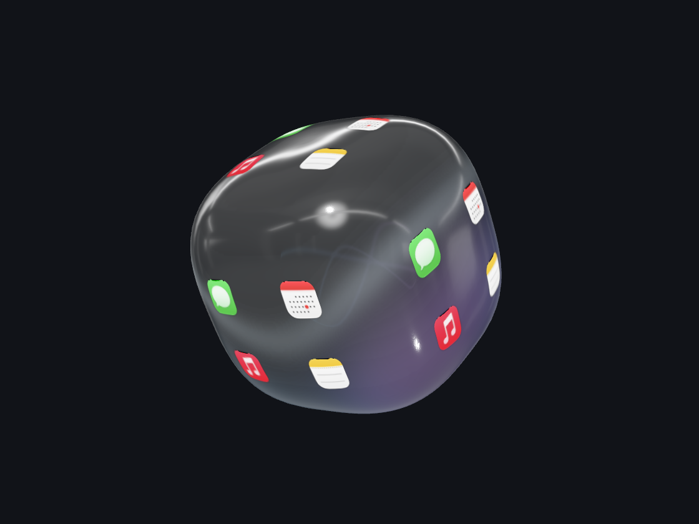
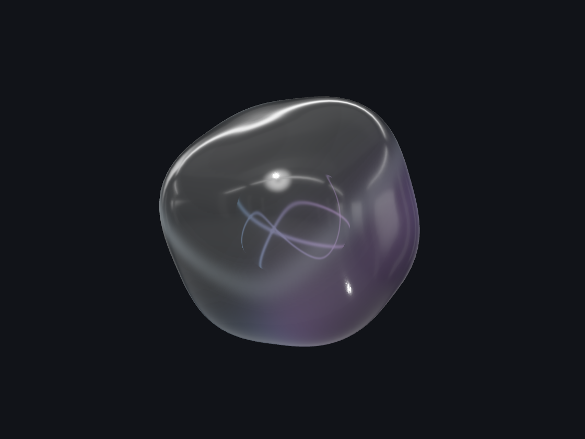
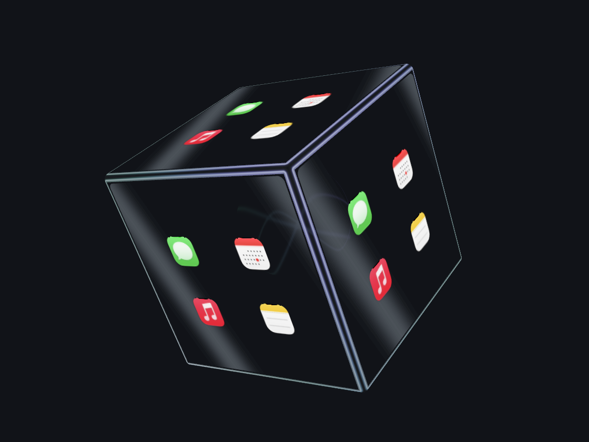
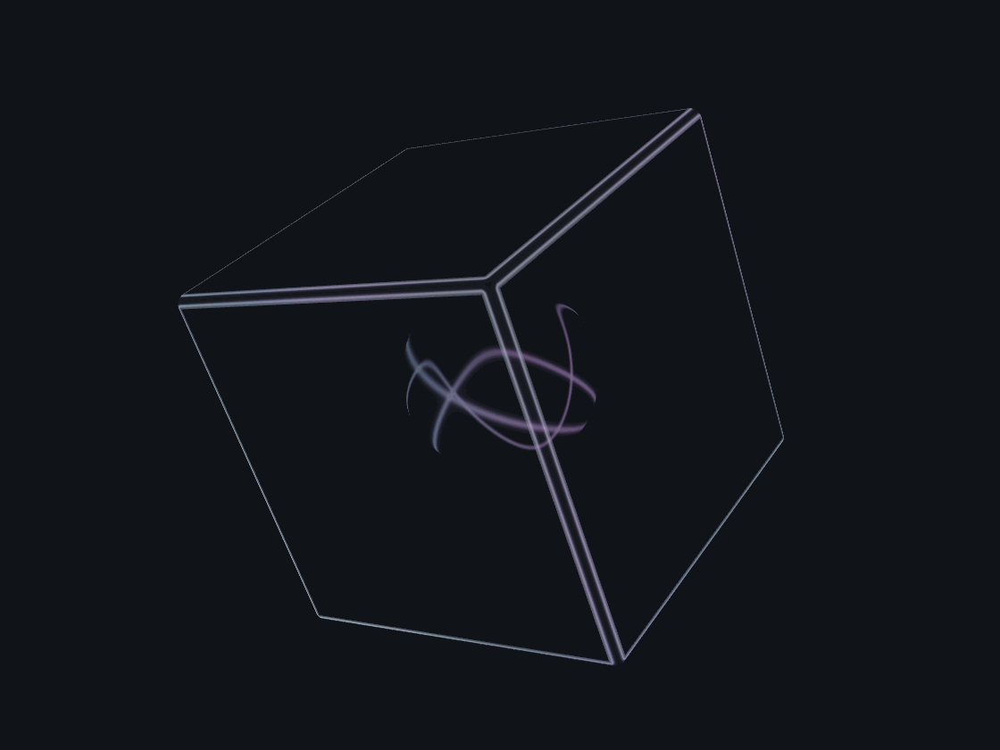
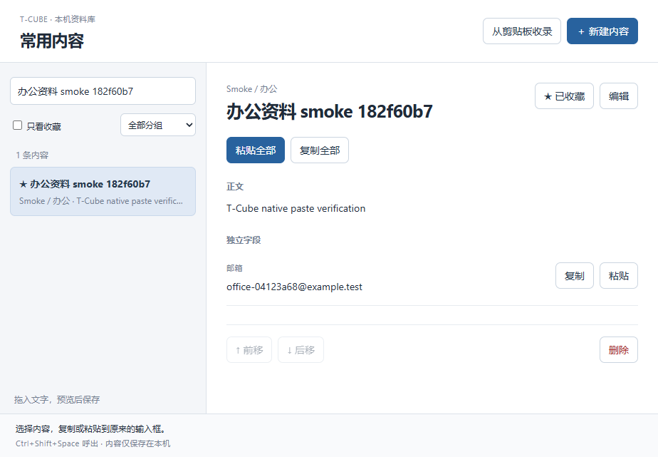

# T-Cube

[English](README.md) | **简体中文**

把常用 App、文件和网页放进一个悬浮在桌面的通透玻璃体。滚动切换六组入口，悬停显示图标，点击打开。

**macOS 15+（原生 Swift） · Windows 10/11（Electron + Three.js）**

## 下载安装包

macOS **0.18.0** · Windows **0.18.0**：[macOS Apple Silicon（.dmg）](https://github.com/gd0306/t-cube/releases/download/v0.18.0/T-Cube-0.18.0-macos-arm64.dmg) · [Windows x64 安装程序（.exe）](https://github.com/gd0306/t-cube/releases/download/v0.18.0/T-Cube-0.18.0-windows-x64-setup.exe) · [发布说明与 SHA-256 校验](https://github.com/gd0306/t-cube/releases/tag/v0.18.0)。

Windows 安装包自带运行时，无需安装 Node.js。更新前先退出旧版，原有入口配置会保留。当前 macOS 使用本地签名、未公证，Windows 安装程序未做 Authenticode 签名。

## 效果预览

玻璃外壳、反光与光晕更轻，让桌面背景清晰透出。悬停后，图标沿曲面显示。

<p align="center">
  
</p>

<table>
  <tr>
    <td align="center"><strong>安静的静置状态</strong><br></td>
    <td align="center"><strong>极光流体</strong><br></td>
  </tr>
</table>

<details>
<summary>查看自动旋转与悬停暂停</summary>
<p align="center"></p>
</details>

以上为应用自身的原生渲染，使用系统示例图标并放大展示细节。所有预览统一使用深石墨色背景、相机角度和画面尺寸。

## 主要功能

- **轻薄通透的玻璃外观**：圆角、平缓弧面和柔和反光，图标清晰地贴合表面。
- **六组入口，每组四个快捷方式**：支持本地 App、文件夹、单个文件、网页与系统设置页面，空位留白，点击区域与曲面图标一致。
- **自由旋转与移动**：双向滚动旋转，悬停时滚哪停哪；左键拖动位置，右键拖动旋转。
- **快捷放置**：从状态栏菜单或「外观 → 快捷位置」一键移到所在屏幕四角或正中央，立即保存，避开菜单栏、Dock 或任务栏。
- **空闲自动旋转**：缓慢、平滑地变换方向；移入立即停转，移出继续。在「外观 → 动态旋转」可关闭；系统开启「减少动态效果」时自动暂停。
- **悬停放大**：移入自动放大、移出恢复，倍率可调为 1.1×～4×。
- **两种打开方式**：先展开面板选择图标，或直接点击立方体面上的图标打开。
- **个性化玻璃**：主题预设、自定义双色渐变、玻璃材质，以及 10 秒／20 秒主题轮换。
- **双端玻璃／史莱姆材质**：所有主题都能搭配任一材质。史莱姆随鼠标牵引并弹性回弹，图标保持稳定；默认仍为玻璃。
- **状态栏常驻**：设置、显示、隐藏与退出集中管理，不占 Dock；光效支持系统「减少动态效果」。

## 内存与资源优化（0.17.1）

减少重复刷新入口、切换主题时的图形资源分配；空面不再创建图标贴图，Windows 应用选择器限制图标缓存。受控压力测试和适用范围见 [内存优化验证](docs/verification/2026-10-30-memory-resources.md)。

## 快捷入口扩展

在入口编辑中选择应用、文件夹、单个文件、HTTP/HTTPS 网页或预设的系统设置页面。文件用默认应用打开，网页用默认浏览器打开；系统设置从列表选择。旧入口与配置继续保留。

## 剪贴板历史试用版（0.18.0）

从菜单栏／托盘「剪贴板历史」或常用内容窗口顶部标签进入，点击「启用记录」后，再复制新的纯文本即可看到记录。支持最新优先、原文去重、搜索、删除、清空、复制、检查原窗口后的粘贴，以及「存为常用内容」草稿；需要点击保存才会进入常用内容库。

每次启动默认暂停，启用／恢复时不读取剪贴板原有内容。历史仅保存在内存中，退出即清除，不进入备份或导出；最多 100 条，单条最多 64 KiB UTF-8，总文本最多 2 MiB。会尽力跳过文件复制及带有敏感、临时或排除标记的内容，但无法识别所有敏感信息；可随时暂停或清空。本版不包含图片历史、持久化或云同步。

## 常用内容模板

编辑内容时启用「作为模板使用」，在正文或字段中用 `{{客户姓名}}` 等占位符创建模板；复制或粘贴时填写变量并预览，同名变量只需填写一次。已有内容默认不启用模板，保持原样复制。

## 办公与性能功能（0.17.1）

双端均提供常用内容库（Windows 使用 `Ctrl+Shift+Space`）：通过菜单栏／托盘「常用内容」或快捷键打开（macOS `⌘⇧Space`，Windows `Ctrl+Shift+Space`），支持分组、收藏、搜索、整段与字段复制，以及授权后的原输入框粘贴。

设置页新增「配置与备份」和「启动与更新」。可预览导入、自动保留导入前备份、手动备份或恢复，并重新关联失效入口。悬停延迟可调；多屏位置独立记忆，断开显示器时回到可见区域。macOS 默认开启静置省电，Windows 默认关闭；可在性能设置中选择。开启时暂停静置旋转和流动光效；鼠标交互后恢复。设置中关闭省电可保留持续动画。Windows 加深玻璃底色和轮廓，改善白底可见度；默认开启单击面展开。主题轮换采用约 0.4 秒柔和过渡，立方体上移除常用内容按钮，保留菜单栏／托盘与快捷键入口。

开机启动通过系统登录项管理，默认不主动注册。已接入 Sparkle 签名更新和 Developer ID/公证构建流程；启用正式更新需要发布者配置 EdDSA 公钥、匹配的签名私钥与发布源。目前未配置公钥的本地构建会明确停用应用内更新，可查看 Releases。详见 [签名与更新发布指南](docs/updates/RELEASE-GUIDE.md)。Windows 同样支持开机启动设置，签名更新说明见 [Windows 指南](docs/windows-signing-updates.md)。



## Windows 源码安装

Windows 10 22H2 / Windows 11（x64）使用独立客户端，支持同样的六组入口、曲面图标、玻璃／史莱姆材质与共享主题、悬停放大、拖动、旋转与托盘设置。添加应用时可直接搜索、选择已安装应用，便携程序可浏览文件添加。可使用上方安装包，也可按 [Windows 指南](windows/README.md) 从源码安装。上面的效果图来自 macOS 原生版。

给本地 AI agent 的简短提示词：

```text
在 Windows 上安装 https://github.com/gd0306/t-cube 的 master 分支。按 windows/README.md 准备 Node.js 22 LTS，运行 windows/scripts/install.ps1。先退出旧版、保留配置，创建快捷方式并启动；报告自测结果。
```

## macOS 安装与运行

当前源码版本为 **0.18.0**，使用 **master** 分支；安装包版本见上方下载链接。

运行需要 macOS 15+；源码构建需要完整 Xcode、Swift 6 和 **macOS 27 SDK**。当前本地打包产物面向 Apple Silicon，使用 ad-hoc 签名，尚未公证。

```bash
git clone --branch master https://github.com/gd0306/t-cube.git
cd t-cube
bash scripts/build-app.sh
open build/T-Cube.app
```

需要自行构建拖拽安装包时，运行 `bash scripts/build-dmg.sh`，打开 `build/T-Cube-0.18.0.dmg`，将应用拖入 **Applications**。更新前先退出旧版，保留原配置。构建产物通过 Releases 分发；系统安全授权由用户确认。

### 让 agent 帮忙安装

复制这段提示词给支持终端操作的 agent：

```text
帮我安装 T-Cube：https://github.com/gd0306/t-cube，使用 master 分支。按 README 构建、安装到 /Applications 并打开。先退出旧版并保留配置；缺少 Xcode/SDK 或需要系统安全授权时告诉我。
```

## macOS 配置与操作

首次运行会打开设置，也可右键单击立方体或从状态栏进入。

1. 在「立方体入口」为六个面添加应用、文件夹、文件、网页或系统设置，也可从 Finder 拖入本地目标。
2. 在「外观」选择主题、材质、轮换与悬停大小，点击「应用设置」保存。
3. 想直接打开图标：在「打开方式」关闭「点击面展开放大」，再点击「应用设置」保存。空白和空槽不触发操作。
4. 从状态栏菜单或「外观 → 快捷位置」选择四角或正中央，立即生效并保存。

体验果冻效果：在「外观 → 材质」选择「史莱姆」，再点击「应用设置」。主题、自定义配色与自动轮换同时适用于两种材质；切换主题不会改变所选材质。选择「玻璃」可恢复原来的刚性外壳。

| 操作 | 效果 |
| --- | --- |
| 鼠标移入／移出 | 显示／隐藏图标；自动旋转开启时暂停／继续旋转 |
| 触控板双指左右／上下滑动 | 沿对应方向旋转，停止后保持姿态 |
| 鼠标滚轮／Shift＋滚轮 | 上下／左右旋转 |
| 左键拖动 | 移动悬浮位置并保存 |
| 右键拖动 | 自由旋转立方体，松手保留当前角度 |
| 鼠标在立方体内时按住 Ctrl | 临时恢复静置大小 |
| Ctrl＋左键拖动 | 按原大小移动，中途松开 Ctrl 也不跳变 |
| 展开后点击外部区域／Esc | 收起图标面板 |
| 右键单击 | 打开设置 |

展开面板只显示四个图标；macOS 26+ 使用 Clear Liquid Glass，旧系统使用毛玻璃。设置页底部或状态栏菜单均可彻底退出应用。

## macOS 本地数据

配置保存在 `~/Library/Application Support/T-Cube/configuration.json`，包含入口、外观、交互偏好和窗口位置。移除快捷方式不会删除目标应用、文件或文件夹；配置损坏时会保留原文件，避免默认配置覆盖数据。

## 开发与验证

```bash
swift test --scratch-path .build/tests
bash scripts/build-app.sh --debug
bash scripts/verify-dmg.sh  # 构建 DMG 后执行
git diff --check
```

重新生成原生效果图，包括统一风格的 `readme-*` 图集：

```bash
env TCUBE_RENDER_PREVIEWS=1 swift test --scratch-path .build/tests --filter 'GlassRenderPreviewTests|IconEdgeRenderingTests'
```

输出位于 `.build/glass-previews/`，使用独立临时配置，不改动用户数据。多背景透明度验证、图标边缘检查与 README 展示图分别生成。

`Sources/CubeCore` 管理配置、几何与命中逻辑；`Sources/TCube` 管理窗口、渲染与原生界面。贡献约定见 [AGENTS.md](AGENTS.md)，检查结果与限制见 [验证记录](docs/verification/)。
