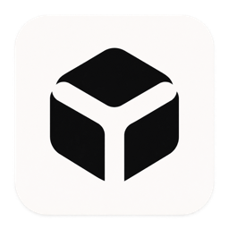
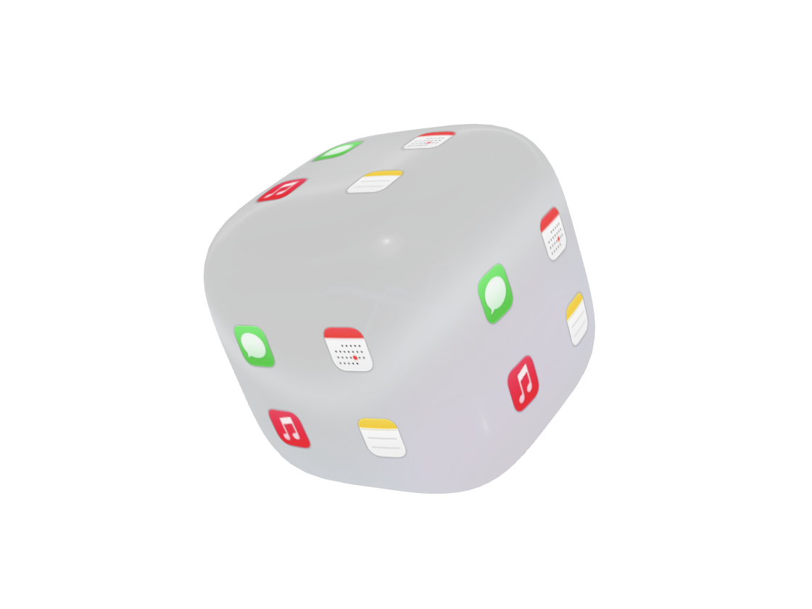
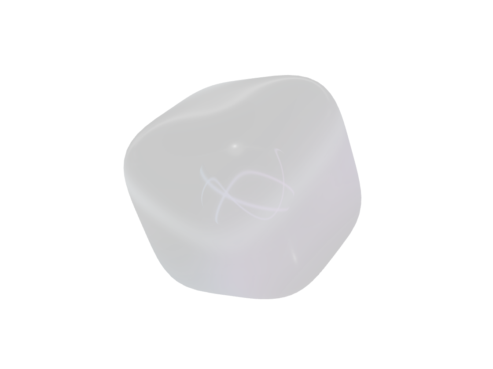
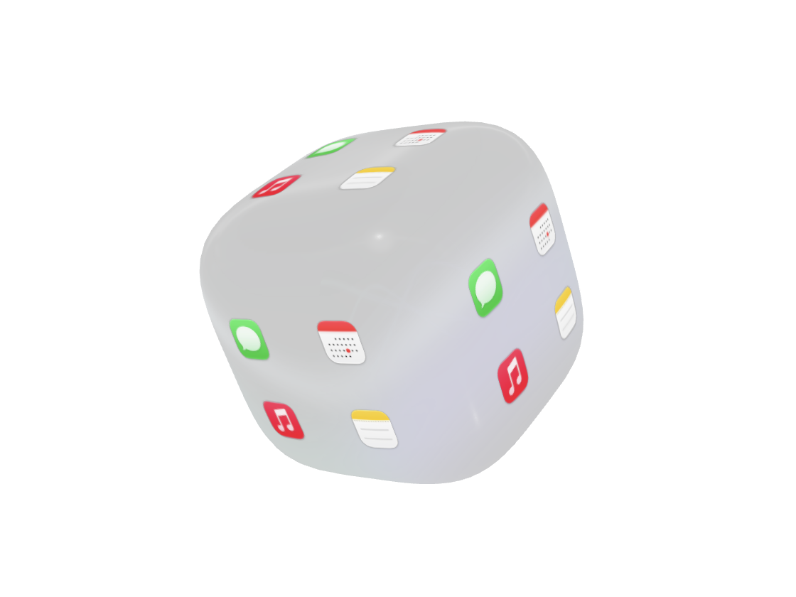
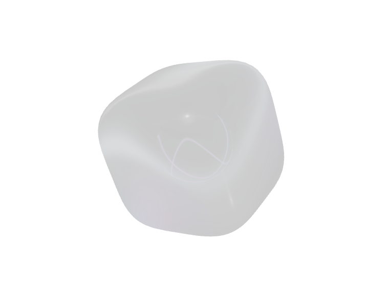

<p align="center">
  
</p>

<h1 align="center">T-Cube</h1>

<p align="center">
  <strong>A transparent 3D glass launcher that floats on your desktop.</strong><br>
  Keep your favorite apps, folders, files, websites, and system controls in one softly rounded shape.<br>
  Scroll to turn, hover to reveal, and click to launch.
</p>

<p align="center">
  <a href="https://github.com/gd0306/t-cube/releases/latest"></a>
  <a href="https://github.com/gd0306/t-cube/actions/workflows/windows.yml"></a>
  <a href="https://developer.apple.com/macos/"></a>
  <a href="https://www.microsoft.com/windows/"></a>
  <a href="https://developer.apple.com/augmented-reality/realitykit/"></a>
  <a href="LICENSE"></a>
  <a href="https://github.com/gd0306/t-cube/stargazers"></a>
</p>

<p align="center">
  <strong>English</strong> · <a href="README-CN.md">简体中文</a>
</p>

---

## Download Installers

Published releases provide ready-to-run installation packages:

| Platform | Version | Installer Package | Target Architecture | Requirements & Notes |
| :--- | :--- | :--- | :--- | :--- |
| **macOS** | `0.22.8` | [T-Cube-0.22.8-macos-arm64.dmg](https://github.com/gd0306/t-cube/releases/download/v0.22.8/T-Cube-0.22.8-macos-arm64.dmg) | Apple Silicon (arm64) | macOS 15+ · Ad-hoc signed |
| **Windows** | `0.22.8` | [T-Cube-0.22.8-windows-x64-setup.exe](https://github.com/gd0306/t-cube/releases/download/v0.22.8/T-Cube-0.22.8-windows-x64-setup.exe) | Windows x64 | Windows 10 (22H2) / 11 · Standalone runtime |

> [!NOTE]
> - View full changelogs and SHA-256 checksums in [GitHub Releases](https://github.com/gd0306/t-cube/releases/tag/v0.22.8).
> - `0.22.8` redesigns settings on both platforms with sidebar navigation and native frosted materials where supported. Appearance changes save immediately with scoped default restoration; Windows gets a blue/cyan tray icon. The [release verification record](docs/verification/2026-11-12-settings-release.md) records source, checksums and verification limits.
> - Both installers package the same source commit; see `SOURCE_COMMIT.txt` and `SHA256SUMS.txt` in the release.
> - Per-entry clipboard text tools are currently a development-source feature and are not included in the `0.22.8` installers above.
> - The Windows installer bundles its runtime and requires no Node.js installation.
> - Quit any running T-Cube instance before upgrading; your configuration is automatically preserved.

---

## Preview

A lighter glass shell lets the desktop show through. Hover to reveal icons that follow its curved surface.

<p align="center">
  <picture>
    <source media="(prefers-color-scheme: dark)" srcset="docs/images/cube-hover-dark.png">
    <source media="(prefers-color-scheme: light)" srcset="docs/images/cube-hover.png">
    
  </picture>
</p>

<table>
  <tr>
    <td align="center">
      <strong>Quiet at Rest</strong><br>
      <picture>
        <source media="(prefers-color-scheme: dark)" srcset="docs/images/cube-idle-dark.png">
        <source media="(prefers-color-scheme: light)" srcset="docs/images/cube-idle.png">
        
      </picture>
    </td>
    <td align="center">
      <strong>Aurora Flow Material</strong><br>
      <picture>
        <source media="(prefers-color-scheme: dark)" srcset="docs/images/cube-aurora-dark.png">
        <source media="(prefers-color-scheme: light)" srcset="docs/images/cube-aurora.png">
        
      </picture>
    </td>
  </tr>
</table>

<details>
<summary><strong>Watch idle rotation and hover response</strong></summary>
<p align="center">
  <picture>
    <source media="(prefers-color-scheme: dark)" srcset="docs/images/cube-motion-dark.png">
    <source media="(prefers-color-scheme: light)" srcset="docs/images/cube-motion.png">
    
  </picture>
</p>
</details>

*Native app renders with sample system icons, enlarged for detail. The cube previews share a transparent canvas, camera, and viewport. Dark pages automatically use a softly lit studio variant to keep the glass silhouette visible. The animation uses APNG to preserve the glass transparency.*

---

## Core Features

### 🧊 3D Aesthetics & Material Physics
- **Frosted Settings**: Sidebar navigation and immediate appearance saving, with a page-scoped default reset. macOS uses native frosted backgrounds; Windows 11 22H2+ uses Acrylic, while older Windows versions and reduced-transparency/high-contrast modes use solid fallbacks. Windows also has a blue/cyan cube tray icon.
- **Clear Liquid Glass & Slime Materials**: Soft corners, shallow curved faces, and subtle reflections. On macOS 26+, content utilizes native Clear Liquid Glass (with frosted glass fallback on earlier systems). Switch to **Slime** material for an elastic jelly body that trails cursor motion and springs back gracefully.
- **Wandering Idle Rotation**: Slowly drifts through shifting 3D angles at rest. Hovering stops rotation instantly; leaving resumes it. Automatically paused when macOS "Reduce Motion" is enabled, or toggle it off under **Appearance → Dynamic Rotation**.
- **Hover Zoom**: Smoothly expands when hovered (customizable from 1.1× to 4.0×) and snaps back to resting size when the pointer leaves.
- **Theme Customization**: Nine theme presets, custom two-color gradients, and optional automatic theme cycling every 10 or 20 seconds with 0.4-second optical crossfades.

### ⚡ Six-Face Multi-Type Launcher
- **24 Quick Slots**: 6 faces with 4 shortcuts each. Empty slots remain clean and transparent; click targets strictly match the curved icons.
- **Versatile Entry Types**: Add local applications, folders, individual files (opens with default app), HTTP/HTTPS web links (opens in default browser), or system settings panes.
- **Real-Time Website Titles**: Web entries display titles directly beneath their icon on both the cube and expanded panels with single-line ellipsis and hover tooltips. Drawn locally without external favicon network requests.
- **Dual Launch Modes**: Choose between expanding a face into a 4-icon panel before opening, or launching immediately by clicking icons directly on the cube.

<p align="center">
  
</p>

### 🖥️ Desktop Ergonomics & Display Control
- **Edge Auto-Collapse**: When positioned within ~32 logical pixels of an outer left/right display edge, leaving the cube for ~0.8 seconds collapses it into a slim 10×56 translucent glass handle. Hovering restores the cube without altering its saved resting position. macOS uses a ~0.36-second droplet absorption and ~0.46-second gentle reveal, with interruption support; Reduce Motion skips spatial transitions. [Native motion preview](docs/images/mac-edge-dock.gif).
- **Fullscreen Auto-Hide**: Automatically hides on the active display when a fullscreen application is focused, pausing 3D rendering to eliminate background GPU overhead.
- **Quick Screen Placement**: Instantly snap the cube to any screen corner or display center from the menu bar or **Appearance → Quick Placement** (automatically accounts for Dock, menu bar, and taskbar insets).
- **Independent Display Brightness (macOS)**: Adjust individual monitor brightness directly from the menu-bar cube. Supports native Apple displays and external monitor hardware backlight control over DDC/CI on Apple Silicon connections. Requires no extra utilities, administrator rights, Accessibility, or Screen Recording permissions.
- **Monitor Input Switching (macOS / Windows)**: Automatically detects connected monitors and keeps each screen’s Type-C / HDMI mapping separate. No model preset or guessed port codes; saved mappings are preserved. Unidentified, ambiguous, or unreadable targets cannot switch. Open **How to obtain input codes** from the monitor’s **Settings…** on macOS, or in the Windows input panel, for the physical-menu → active-host Refresh → record both decimal codes → save → verify procedure. macOS external input control requires Apple Silicon and a usable DDC/CI connection; detection alone does not guarantee hardware compatibility. Controls lock while busy and highlight confirmed input only, without background polling. [Implementation and limits](docs/verification/2026-11-07-display-input-discovery.md).

### 📋 Productivity Suite: Clipboard & Reusable Content
- **In-Memory Session Clipboard**: Text and image history kept strictly in volatile memory. Cleared immediately on exit; never written to disk, included in backups, or transmitted over the network.
  - **Text History**: Retains up to 100 entries (64 KiB per entry, 2 MiB total). Supports search, multi-selection, ordered concatenation, line trimming, and repeated blank-line collapsing.
  - **Image History**: Retains up to 10 recent images (8 MiB normalized PNG per image, 32 MiB total, 16 megapixels max) with thumbnail previews and bounded detail views.
- **Quick Clipboard Panel (macOS / Windows)**: With the pointer outside the cube, hold `Ctrl` alone for **1 second** to open a glass history list near the pointer. Release `Ctrl`, then single-click text or an image to copy it and close the panel. Edit, save, cancel, or delete text records; editing changes session history only, preserving order and capture time. Other keys, mouse buttons, scrolling, or entering the cube cancel the hold until Ctrl is released; cube resizing and dragging take priority. Recording starts automatically with the app and can be paused for the current session; existing clipboard content is not imported at startup. macOS uses a native frosted material; Windows 11 22H2+ uses acrylic, with a solid fallback on Windows 10 and earlier Windows 11 builds. Drag the title to move the panel; every fresh invocation returns to the history list. System accessibility preferences may reduce transparency. [Preview and verification](docs/verification/2026-11-10-clipboard-quick-panel.md).
- **Per-entry Text Tools (development source)**: Open the processing menu beside a text record to preview plain text, whitespace cleanup, case conversion, JSON formatting/minification or URL component encoding/decoding. Copy the result, or edit it before copying or explicitly saving to that session record. Processing stays local; previews do not overwrite history. [Preview and verification](docs/verification/2026-11-13-clipboard-text-tools.md).
- **Snippet Library & Dynamic Templates**: Open the content library from the status menu or with `Command+Shift+Space` (`Ctrl+Shift+Space` on Windows). Organize reusable snippets with groups and favorites. Enable template mode to use dynamic placeholders like `{{customer_name}}`—fill variables once and preview the merged result before copying or pasting.
- **Focus-Checked Direct Paste**: Restores previous window focus and pastes directly into the target input field when Accessibility permissions are granted.

### ⚙️ Performance & Low-Power Architecture
- **Idle Power Saving**: Pauses 3D rendering and flowing light while the cube is stationary (defaults to enabled on macOS).
- **Resource Reuse**: Unchanged textures are cached across refreshes, empty faces allocate no texture atlases, and Windows application-picker icon retention is strictly bounded.
- **Refined Modular Settings**: Appearance, Desktop & Performance, Shortcut Groups, Maintenance, and Lifecycle are organized into clear tabs with instant-save feedback.
- **Lightweight Release Reminders**: Anonymous 6-hour check for GitHub Releases (opt-in, default off) with manual check cooldown, opening the release page for manual download.
- **Login Startup**: Enabled by default when the installed app first starts. Turn it off in settings; the choice is remembered across restarts. System approval requirements and disabled login items are respected.

---

## Controls & Gestures

| Input Action | Interaction Result |
| :--- | :--- |
| **Hover / Leave** | Reveal / hide surface icons; pause / resume idle rotation |
| **Trackpad 2-finger scroll** | Rotate cube along horizontal / vertical axis (stops smoothly without snapping) |
| **Mouse wheel / Shift + wheel** | Rotate vertically / horizontally |
| **Left-button drag** | Move and save floating position |
| **Right-button drag** | Free-form 3D rotation; release to keep current angle |
| **Hold `Ctrl` over cube** | Temporarily restore cube to resting size; this press does not open clipboard history |
| **`Ctrl` + Left-button drag** | Move at resting size (persists even if `Ctrl` is released mid-drag) |
| **Hold `Ctrl` alone for 1 second outside the cube** | Open clipboard history; release, then single-click a record to copy. Click outside to close; use Save / Cancel when editing |
| **Click outside / `Esc`** | Dismiss expanded 4-icon panel |
| **Right-click / Menu Bar icon** | Open settings |

---

## Getting Started & Configuration

Settings open automatically on first launch, or reopen them anytime by right-clicking the cube or using the menu-bar icon.

1. **Cube Entries**: Assign apps, folders, files, websites, or system settings to each face. Drag-and-drop from Finder / Explorer is fully supported.
2. **Appearance**: Choose materials (**Glass** or **Slime**), color themes, hover zoom scale, and theme cycling intervals. Changes take effect and save immediately; **Restore Default Appearance** resets only the appearance page.
3. **Launch Behavior**: On macOS, open **Appearance → Interaction & Animation**; on Windows, open **Interaction & Placement**. Toggle **Expand faces on click** to choose panel expansion or direct launching.
4. **Desktop & Placement**: Configure **Edge Auto-Collapse**, **Fullscreen Auto-Hide**, or use **Quick Placement** to position the cube at screen corners or center.
5. **Display Input**: Open the input controls from the macOS status menu or Windows tray menu, then identify the intended monitor by name and displayed ID. On macOS, open the monitor’s **Settings…** and choose **How to obtain input codes**; on Windows, expand that help in the input panel. Follow these steps: enable DDC/CI, physically activate Type-C and HDMI in turn, and refresh T-Cube on each active host to record its current decimal code. Save two distinct codes locally on each host; saving does not switch inputs. If you previously relied on the automatic preset without saving a mapping, calibrate once using this procedure. Reconnection refreshes detection without transferring mappings to a different screen. If switching loses readback, selection clears and the result remains unconfirmed; use the active host or the monitor’s physical menu to switch back.

---

## Build from Source

### macOS (Native Swift 6)

- **Runtime**: macOS 15+
- **Build Requirements**: Full Xcode with Swift 6 and the macOS 27 SDK.
- **Target Architecture**: Apple Silicon (arm64).

```bash
# Clone the repository
git clone --branch master https://github.com/gd0306/t-cube.git
cd t-cube

# Compile and launch the app
bash scripts/build-app.sh
open build/T-Cube.app

# (Optional) Package a drag-to-install DMG installer
bash scripts/build-dmg.sh
open build/T-Cube-0.21.1.dmg
```

### Windows (Electron + Three.js)

- **Runtime**: Windows 10 (22H2) or Windows 11, x64.
- **Build Requirements**: Node.js 22 LTS or newer, Git, and PowerShell.

```powershell
# Clone the repository
git clone --branch master https://github.com/gd0306/t-cube.git
cd t-cube

# Run automated installer script (builds and installs to %LOCALAPPDATA%\T-Cube)
powershell -NoProfile -ExecutionPolicy Bypass -File windows/scripts/install.ps1
```

For detailed Windows developer workflows and NSIS package building, see the [Windows Guide](windows/README.md).

### Let an AI Agent Install It

You can delegate the entire build and installation process by giving a local terminal agent one of these prompts:

<details>
<summary><strong>macOS Agent Prompt</strong></summary>

```text
Install T-Cube from https://github.com/gd0306/t-cube (master). Follow the README to build, install to /Applications, and launch it. Quit any running version first and preserve existing configuration. Tell me if Xcode/SDK requirements or macOS security approvals need attention.
```
</details>

<details>
<summary><strong>Windows Agent Prompt</strong></summary>

```text
Install https://github.com/gd0306/t-cube (master) on Windows. Follow windows/README.md, prepare Node.js 22 LTS, and run windows/scripts/install.ps1. Quit the old app first, preserve settings, create shortcuts, launch, and report test results.
```
</details>

---

## Local Data & Privacy

- **macOS Configuration**: `~/Library/Application Support/T-Cube/configuration.json`
- **Windows Configuration**: `%APPDATA%\T-Cube\configuration.json` and `%APPDATA%\T-Cube\applications`

Per-monitor input mappings are stored separately in `display-inputs.json` beside the configuration on each computer; calibration does not change the monitor’s source. These hardware-specific mappings are not included in the existing launcher configuration export.

Configuration files store shortcut bindings, material/appearance choices, interaction tuning, and window coordinates. Removing a shortcut never deletes the original target file or application. Corrupted configurations are preserved rather than silently overwritten with default values.

T-Cube is 100% offline and privacy-first: no telemetry, no tracking, and no cloud synchronization.

---

## Development & Verification

Run tests and verification suites locally:

```bash
# Run unit and behavior tests
swift test --scratch-path .build/tests --no-parallel

# Compile debug bundle
bash scripts/build-app.sh --debug

# Verify DMG signature, layout, and links
bash scripts/verify-dmg.sh

# Check git whitespace
git diff --check
```

Regenerate native high-resolution preview renders:

```bash
env TCUBE_RENDER_PREVIEWS=1 TCUBE_README_THEME_PREVIEWS=1 TCUBE_WEBSITE_PREVIEWS=1 swift test --scratch-path .build/tests --no-parallel --filter 'GlassRenderPreviewTests|ReadmeThemePreviewTests|IconEdgeRenderingTests|WebsiteTitlePreviewTests'
```

- `Sources/CubeCore`: Reusable data models, geometry, hit testing, rotation, and theme engines (framework-independent).
- `Sources/TCube`: macOS application lifecycle, RealityKit 3D rendering, floating windows, display brightness bridges, and SwiftUI settings.
- `windows/src/`: Windows Electron main process, Win32 native bridge, and Three.js rendering pipelines.

Refer to [AGENTS.md](AGENTS.md) for contribution conventions, [the release checklist](docs/releasing.md) for delivery requirements, and [docs/verification/](docs/verification/) for test records and hardware validation boundaries.
