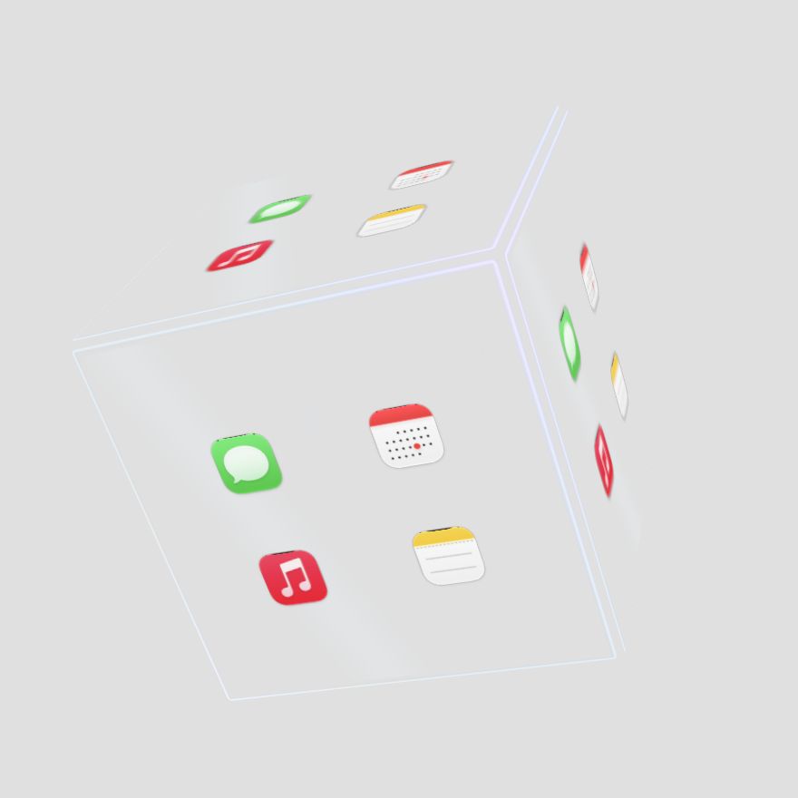

# T-Cube

把常用 App 和文件夹放进一颗悬浮在桌面的玻璃立方体。滚动切换六个面，悬停显示图标，点击打开入口。

**macOS 15+ · Swift 6 · AppKit / SwiftUI / RealityKit · 无第三方依赖**

## 效果预览

<table>
  <tr>
    <td align="center"><strong>悬停显示图标</strong><br></td>
    <td align="center"><strong>静置透明轮廓</strong><br></td>
  </tr>
  <tr>
    <td align="center"><strong>浅色背景</strong><br></td>
    <td align="center"><strong>动态流光</strong><br></td>
  </tr>
</table>

以上为应用自身的原生渲染预览，使用固定背景与系统示例图标，放大展示细节。

## 主要功能

- **六面入口**：每面最多四个 App 或文件夹，只显示图标，空位留白。
- **自由旋转与移动**：触控板双指滚动或鼠标滚轮旋转，滚哪停哪；左右键均可拖动位置。
- **悬停放大**：移入自动放大，移出恢复；倍率可调，默认 4 倍。
- **两种打开方式**：点击面展开四个图标，或直接点击立方体面上的图标打开。
- **主题与材质**：九种预设、自定义双色渐变、玻璃材质，以及 10 秒／20 秒主题轮换。
- **状态栏常驻**：设置、显示／隐藏和退出集中在状态栏菜单，不占 Dock。

## 安装与运行

当前版本为 **0.9.0**，源码位于 `feat/theme-cycle-hover` 分支。

运行需要 macOS 15+；源码构建需要完整 Xcode、Swift 6 和 **macOS 27 SDK**。当前本地打包产物为 Apple Silicon 架构，使用 ad-hoc 签名，尚未公证。

```bash
git clone --branch feat/theme-cycle-hover https://github.com/gd0306/t-cube.git
cd t-cube
bash scripts/build-app.sh
open build/T-Cube.app
```

需要 DMG 时运行 `bash scripts/build-dmg.sh`，打开生成的 `build/T-Cube-0.9.0.dmg`，将应用拖入 **Applications**。更新前先退出旧版，保留原有配置。构建产物不随源码提交；遇到系统安全提示时由用户确认。

### 让 agent 帮忙安装

复制这段提示词给支持终端操作的 agent：

```text
帮我安装 T-Cube：克隆 https://github.com/gd0306/t-cube 的 feat/theme-cycle-hover 分支，按 README 构建，安装到 /Applications 并打开。更新前退出旧版、保留原配置；缺少 Xcode/SDK 或遇到安全授权时先告诉我。
```

## 配置与操作

首次运行会打开设置，也可右键单击立方体或从状态栏进入。

1. 在「立方体入口」为六个面添加应用或文件夹，也可从 Finder 拖入。
2. 在「外观」选择主题、材质、轮换和悬停倍率，点击「应用设置」保存。
3. 想直接打开图标：在「外观 → 打开方式」关闭「点击面展开放大」，再应用设置。空白与空槽不会触发操作。

| 操作 | 效果 |
| --- | --- |
| 触控板双指左右／上下滑动 | 沿对应方向旋转，停止后保持姿态 |
| 鼠标滚轮／Shift＋滚轮 | 上下／左右旋转 |
| 按住左键或右键拖动 | 移动悬浮位置并保存 |
| 鼠标在立方体内时按住 Ctrl | 临时恢复静置大小 |
| Ctrl＋左键拖动 | 按原大小移动，中途松开 Ctrl 也不跳变 |
| 展开后点击外部区域／Esc | 收起图标面板 |
| 右键单击 | 打开设置 |

展开面板仅显示四个图标；macOS 26+ 使用 Clear Liquid Glass，旧系统使用毛玻璃。主题光效支持系统「减少动态效果」。设置页底部或状态栏菜单均可彻底退出应用。

## 本地数据

配置保存在 `~/Library/Application Support/T-Cube/configuration.json`，包含入口、主题、交互方式和窗口位置。移除入口不会删除本地应用或文件夹；配置损坏时会保留原文件，避免默认配置覆盖数据。

## 开发与验证

```bash
swift test --scratch-path .build/tests
bash scripts/build-app.sh --debug
bash scripts/verify-dmg.sh  # 构建 DMG 后执行
git diff --check
```

重新生成原生效果图与动图：

```bash
env TCUBE_RENDER_PREVIEWS=1 swift test --scratch-path .build/tests --filter GlassRenderPreviewTests
```

输出位于 `.build/glass-previews/`，使用独立临时配置，不改动用户数据。

`Sources/CubeCore` 管理配置、几何与命中逻辑；`Sources/TCube` 管理窗口、渲染和原生界面。贡献约定见 [AGENTS.md](AGENTS.md)，验证记录见 [docs/verification](docs/verification/)。
