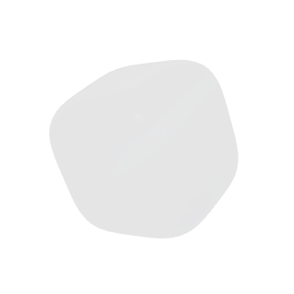
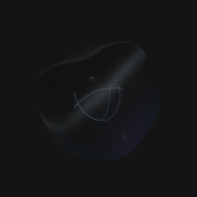
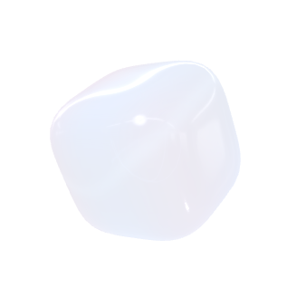

# macOS light-background material contrast

## Change

The macOS glass shell previously relied on faint white reflections. Actual
RealityKit snapshots without launcher icons reproduced zero visible coverage on
white for all nine glass themes at a minimum channel contrast of 18/255.

The existing glass shell now uses neutral absorption, with lower specular and
clearcoat strength to retain transparency instead of illuminating its center.
Pearl reflections and theme colors remain in their existing optical layers.
The slime shell also gains absorption so pale moonstone remains visible.
There are no additional entities, textures, render passes, or animation updates.
Theme transitions, rendering suspension, configuration, and Windows are unchanged.

## Automated verification

- `env TCUBE_RENDER_PREVIEWS=1 swift test --scratch-path .build/tests --no-parallel`
  passed: 4 XCTest, 80 native Swift Testing, and 98 core cases (182 total).
- New real-render regression covers both materials, all nine themes, and white
  and dark backgrounds without icons. Coverage requires channel contrast of at
  least 18/255 over 1.5% of the white viewport and 0.4% of the dark viewport.
  Glass now covers about 30% on white and at least 4% on dark. Pale moonstone
  slime covers about 3.9% on white.
- The additional six-face glass check freezes animation and measures the same
  fixed central region on each background, including pearl reflections in the
  average. Background response ranges from 0.742 to 0.835 (required >0.70).
- The pre-existing full-glow single-point transmission assertion is unchanged
  and passes at 0.731 (required >0.70). Icon-edge, input, rendering lifecycle,
  and theme-transition regressions also pass.
- `bash scripts/build-app.sh` and `git diff --check` passed.
- Independent read-only review covered material scope, fixed-phase sampling,
  transparency, and preservation of the original full-glow check.

## Captures and local installation

Production RealityKit snapshots, visually inspected:

| Glass on white | Glass on dark | Moonstone slime on white |
| --- | --- | --- |
|  |  |  |

The release-configuration app was copied to `/Applications/T-Cube.app` after
stopping the previous process. Installed executable matches the built executable
and `codesign --verify --deep --strict` passes. Existing user data was not copied
or replaced. Executable SHA-256:
`7eaf0168b4f383d9404e6ad2bedacdef7966479b023880311cf122e18d77d9d5`.

Native desktop control failed to start (`Sky Computer Use native pipe startup
failed`), including after reconnect/reset. Consequently the installed app has
not been automatically reopened or manually inspected on the desktop; the user
must reopen T-Cube. Visual evidence above comes from native rendering tests.
This is a local hotfix build; existing release assets were not replaced.
