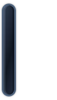

# System appearance edge glass / 0.20.1 (36)

The user approved changing only the collapsed edge handle: OS light appearance uses white frosted glass, dark appearance uses deep space black, with a quiet internal moving light. Cube themes and theme cycling remain unchanged. Logical hit geometry stays 10×56, including the Windows native minimum-width container alignment and shaped hit region; the visible capsule is 8×52 at (1,2).

## Rendering and resource behavior

macOS uses an adaptive `NSVisualEffectView` with behind-window blending, a small tint/rim gradient and one cached shimmer layer. The keyframe translation takes eight seconds with a preferred 24 FPS range (12–30); no application frame callback or timer is added. Animation requires presented + visible + non-occluded state and allowed motion/transparency. Reduced motion, reduced transparency and macOS Low Power Mode keep a static reflection. Hidden/shutdown states remove the animation. Appearance, accessibility, power and occlusion updates are event driven; Combine subscriptions use weak owners and are cancelled at shutdown/deallocation. Backing-scale changes refresh the tiny raster cache. [Apple material documentation](https://developer.apple.com/documentation/appkit/nsvisualeffectview).

Windows uses local packaged HTML/CSS/TypeScript, system color-scheme media and a single child gradient animation (8.4 seconds). Reduced-motion/transparency and forced-colors modes are static. Actual document visibility and page lifecycle cancel the animation and release `will-change`; there are no JavaScript timers, requestAnimationFrame calls, canvas or WebGL. Existing native container shaping and reveal behavior remain unchanged. This is frosted styling, not a claim of desktop backdrop blur on shaped transparent Windows windows. Strict local CSP, sandboxing, context isolation and navigation restrictions remain intact.

Neither implementation wakes the cube renderer, adds a window, fetches images, changes launcher data or adds persistent configuration fields. Limits and gating describe this decoration, not a universal total-application CPU/RSS guarantee.

## Verification

- Regression-first native test reproduced the old solid accent slab having no background material. Static-reflection regression reproduced transform-dependent frame layout pushing the reduced-motion reflection out of the capsule; bounds/position layout now preserves its translated location.
- `swift test --no-parallel --scratch-path .build/tests` passed: 6 XCTest, 146 native Swift Testing and 126 core registered; 269 actually executed/passed, nine opt-in diagnostic/live/render cases skipped. A separate enabled native preview run passed all four edge view cases and checked visible material pixels in both appearances.
- Tests cover light/dark changes on the same layer hierarchy, 40 reveal/hide cycles with exactly one/zero flow animations, occluded/visible restoration, reduced motion/transparency, shutdown, accessibility press, unchanged hit geometry and the existing 30-cycle real RealityKit detach/window-count test.
- The host reported a test panel as visible but fully occluded (raw state 8192, while the public visible bit is 2), correctly suppressing flow. Unit fixtures inject only the window-visibility input to test transitions deterministically; production retains the native visibility + non-occlusion predicate. No production gate was weakened to make the test pass.
- Node 22 typecheck, build and all 226 registered local cases passed (225 executed/passed, one Win32-only case skipped on macOS). Actual Chrome renderer checks cover live light/dark changes, reduced motion/transparency/forced colors, hide/reveal cancellation, repeated-show animation count and absence of script frame/timer loops. Actual Electron checks additionally exercise initially-hidden painting, four visibility cycles, private media emulation, strict CSP and right-container translation. These use owned windows/media overrides, not global OS appearance changes.
- Native and renderer previews were inspected. The macOS view-cache export shows actual tint, rim and static reflection; live WindowServer desktop backdrop blur was not screen-captured. Windows screenshots use the actual packaged renderer.
- Independent read-only review found no important remaining issues in animation lifecycle, resource gates, weak observations, palette updates, packaging/CSP, container alignment or the final transform-independent static reflection fix.
- Release app build, mounted DMG checksum/files/signature/Applications-link verification and `git diff --check` passed.

## Preview artifacts

| macOS light | macOS dark | Windows light | Windows dark |
| --- | --- | --- | --- |
|  |  |  |  |

## Local and remote acceptance

Old app and all four recursive user JSON files were backed up under ignored `build/install-backups/0.20.1/20261103-181027/`. The running app must quit normally before replacement, per AGENTS.md. Installation, native Windows CI, artifact hashes and publication will be recorded after those checks complete. The computer-use native service was unavailable; automated checks and manual desktop verification remain explicitly separate.
