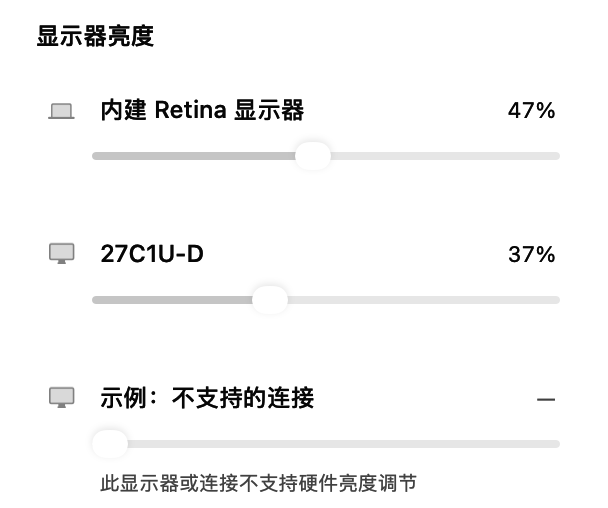
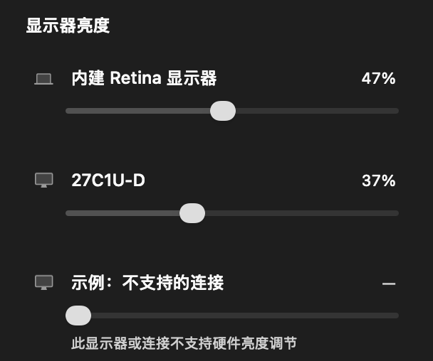

# macOS status-menu hardware brightness / 0.21.0 (39)

The user asked for brightness and audio controls from the macOS status item, then explicitly deferred audio. This release adds only per-display brightness to the existing status menu: name, percentage and native slider for each online screen. Existing commands remain below it. Apple/native brightness is tried first; external Apple Silicon DDC/CI controls actual backlight, not an overlay or gamma filter. Unsupported channels remain visible with a disabled slider and a reason.

## Hardware and resource behavior

Screen IDs are bound to CGDisplay UUIDs, not monitor names or list order. The C bridge checks online UUID before each physical operation. External service mapping uses CoreDisplay's exact IODisplayLocation/framebuffer registry identity, then the corresponding external DCP proxy segment, rejecting ambiguous services. Native DisplayServices/CoreDisplay/IOAV interfaces are dynamically resolved; unavailable symbols fail gracefully. External Intel DDC is unsupported in this first Apple Silicon implementation. Some adapters, DisplayLink/virtual paths and monitor settings do not expose DDC; hardware compatibility remains conditional.

Read requests validate brightness VCP 0x10, response source/length/opcode/status/type, checksum, positive maximum and current <= maximum. Sixteen-bit ranges are preserved. Every write scales against a fresh real maximum and verifies hardware readback. Raw I2C/native calls use a dedicated serial queue; canceled queued requests stop before touching hardware. CF/IORegistry objects are released on every path. Upstream MIT attribution and full notices ship in the app Resources (m1ddc and AppleSiliconDDC).

Opening the menu reads current hardware values asynchronously. Closing cancels refreshes; there is no background polling or automatic startup brightness restoration. Dragging retains at most one active write plus the latest pending value per display, debounced by 100 ms, and drains the last user value even after dismissal. Generation/edit/token guards discard stale refresh/readback results; topology changes invalidate old work, and failed writes recover actual values where readable. Menu view instances remain stable during drag. No 3D renderer work, global key capture, helper process, administrator operation or new configuration field is added. The slider paths do not request Accessibility or screen recording.

## Verification

- Codec tests observed red then green: independent literal Get/Set packets, checksum/header/result/code/type corruption, bad lengths, zero/invalid maxima, 16-bit ranges and NaN/infinite/out-of-range input.
- Controller tests observed red then green, now nine cases: no closed-menu I/O, asynchronous reads, one active+latest coalescing, final value after dismissal, stale reads, failure rollback, invalid/unsupported requests, pending and active writes across reused-ID/UUID replacement, and failure-readback racing a newer edit.
- Native menu row tests observed red then green: correct monitor identity/value routing, disabled unsupported reason and stable slider object across updates. A synchronous XCTest opens a real owned NSMenu: async reads update while event tracking, a slider edit reaches the fixture hardware before the menu closes, and the original command remains present. Timers are test-only bounded tracking fixtures; product code has none.
- Final `swift test --no-parallel --scratch-path .build/tests`: seven XCTest + 166 native + 130 core registered, 291 executed/passed, 12 opt-in/live/preview cases skipped. Separately enabled menu previews/read-only hardware checks and all focused cases pass. Native light/dark menu previews were inspected; the third unsupported row is explicitly an example, not a claim about the maintainer's connected screens.
- Production hardware path was exercised on this Mac: Built-in Retina Display native 0.471175462 → 0.481175482 → restored 0.471175462; 27C1U-D DDC 0.37 → 0.38 → restored 0.37. These were small reversible physical writes, read back from hardware. User JSON was not used as a fixture or modified by the feature.
- Review found one test cleanup issue: cancellation could suppress restoration in the canceled caller. A new nonphysical regression observed CancellationError with the original helper; restoration now awaits an independent uncanceled task and the regression passes. The completed physical run had already restored both screens. Follow-up scoped review confirms the cancellation protection/lifetime behavior; no extra physical write was needed.
- Bridge checks include strict arm64/x86_64 compilation, clang static analysis, ASan/UBSan, malformed/non-brightness requests, invalid UUIDs and missing symbols. Both physical screens were read without changing them in those checks. MCDP29xx alternate-address path is implemented but not available for live testing on this machine.
- Node 22 typecheck/build and Windows unit checks passed: 226 passed, one platform-only case skipped on macOS. Windows functionality is unchanged; package version is aligned at 0.21.0 because both clients compare against the shared GitHub latest release tag.
- Independent core and whole-feature read-only reviews found no production blocker; the minor cleanup finding was fixed and re-reviewed.
- Release app build, mounted DMG checksum/signature/executable/Applications-link/install-note checks and git diff --check passed. Bundled ThirdPartyNotices.txt matches the source notice file byte for byte.

## Controlled native previews

| Light | Dark |
| --- | --- |
|  |  |

## Local acceptance

Computer-use native access recovered. The old application was normally quit by selecting its native Quit menu item; subsequent process absence was verified. The previous app plus all four recursive user JSON files were preserved under ignored `build/install-backups/0.21.0/20261104-172804/`, with another data snapshot after quit. Build 39 was staged, signature verified, installed into /Applications/T-Cube.app and started. Built/staged/installed executable hashes match; all four JSON files matched the post-exit snapshot before launch. Installed executable SHA-256: `cecf08474447c320f2e6bf787b1a9d49175c509629a95355de40895a6a2cefb7`.

The recovered desktop channel could inspect the app's edge window and native app menu but did not locate its extra status icon; an independent click on the installed extra status icon was not captured through this desktop channel. This is separate from automated real NSMenu tracking and the live production hardware write/read/restore above. Exact-source Windows CI, artifact provenance and publication are recorded below.

## Remote acceptance and publication

Application source commit: `646bbf13d19201dbeb3ede707c63605949ac9758`.

- [Windows 2022/2025 source verification](https://github.com/gd0306/t-cube/actions/runs/41829136040) passed on both runners at this source.
- [Windows NSIS build and actual installed application verification](https://github.com/gd0306/t-cube/actions/runs/41829261269) passed at the same source. Downloaded SOURCE_COMMIT.txt matches the full source; the installer hash matches its CI checksum. Source and installer diagnostics each contain 25 native checks and four hidden cycles with zero animations and released compositor hints.
- A transient TLS failure interrupted the first git push. An installer dispatch made before that ref reached the remote failed checkout and was replaced by the successful exact-source run above; it was not used as a release artifact.
- macOS DMG SHA-256: `c4d4bfe307c6ba7ade28337afe3b1fe9bef48586896df0045b4b1a30be54bcfc`.
- Windows installer SHA-256: `b45fc736821746f3e0920ab16b3320b72430e57b960cf925ce42277a3c837602`.
- [Release v0.21.0](https://github.com/gd0306/t-cube/releases/tag/v0.21.0) is public and latest. Both installers and SHA256SUMS.txt match local byte sizes and uploaded SHA-256 digests. The public checksum download was compared byte for byte. The tag remains on the validated application source; later master changes only record acceptance.
