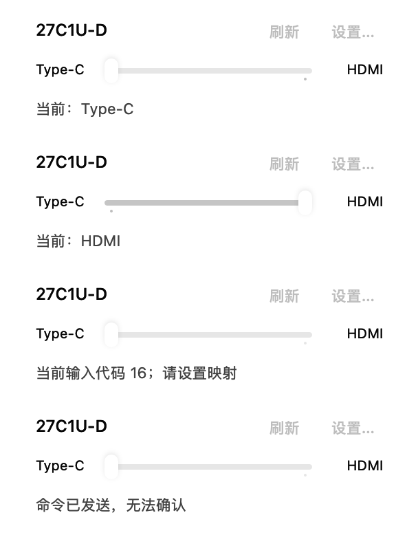
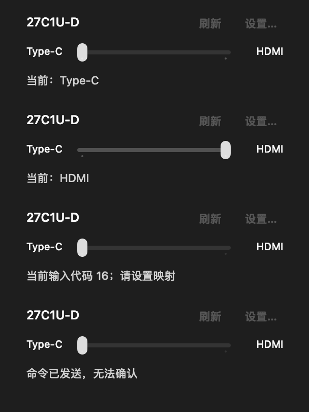
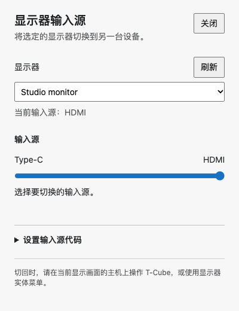
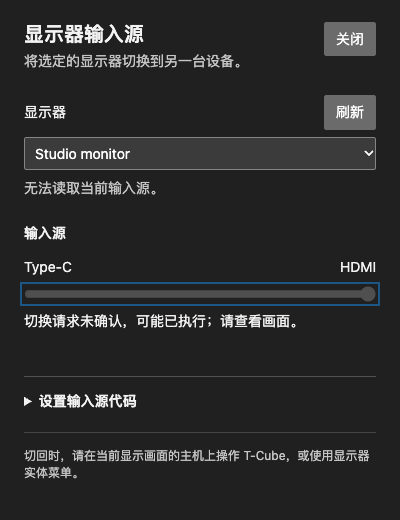

# Calibrated monitor input switching — 0.22.0

## Scope and hardware evidence

The status menu on macOS and tray context-menu panel on Windows offer Type-C on the left and HDMI on the right. Slider commits send one application-level operation; the Apple Silicon transport retains its validated two transmissions, with 50 ms input-command spacing. Brightness keeps its existing 10 ms spacing and shares the serial hardware queue. There is no source polling in the background, automatic source restoration, volume feature or network relay.

Physical tests used a 27C1U-D with Mac USB-C and Windows HDMI. Its observed VCP0x60 values were Type-C7 and HDMI5, maximum14. Advertised HDMI17 did not change the picture. A single Mac transmission did not switch; two transmissions did. Windows SetVCPFeature7 switched to Mac. The second Windows monitor (GWD0140, current16/max3) was not written.

After switching away, the source host lost valid readback. Mac returned a DDC null frame (`6E80BE` with stale trailing bytes), which the codec rejects; Windows returned error0xC0262589. The user also ran a controlled Windows test that switched to Type-C then attempted HDMI5 from inactive Windows without a preflight read. The API accepted both writes, but the user confirmed the image stayed on Mac. Thus a successful API return alone is not evidence that this monitor switched; inactive write-only recovery failed in these tested connections. The user explicitly chose the lightweight each-host approach over LAN collaboration.

Only an exact known-model identification selects the27C1U-D preset automatically. A generic IOCFFFF product marker alone is insufficient on Windows; the EDID model descriptor and base-block checksum must match. Other DDC-capable monitors use explicitly calibrated distinct16-bit port numbers. Full stable interface/UUID identity, never list order or generic name, scopes mappings and hardware calls. Clones/ambiguous identities are rejected.

## Implementation boundaries

Each host keeps its own bounded, versioned `display-inputs.json`, separate from existing launcher JSON schemas and configuration export. Calibration does not send Set. Atomic persistence preserves malformed existing bytes; cancellation is checked at the commit boundary. Unknown/unmapped/unsupported sources disable switching and leave configuration or refresh available.

Windows uses a dedicated short-lived Electron-as-Node process per hardware job. A15-second deadline bounds driver stalls; terminating that process lets the OS reclaim its handles. A durable per-job marker and structured child errors distinguish preflight failure, explicit Set rejection, cancellation before Set, and an interrupted write whose result is unknown. There are no retries. Exact panel webContents/main-frame authorization precedes narrow IPC validation; no arbitrary VCP, registry path or launcher privilege is exposed to its renderer.

Accepted writes with missing readback are unconfirmed. Valid unchanged readback is not applied; a third input is reported honestly and cannot be switched again until recognized. Switch back from T-Cube on the currently displayed computer or the physical OSD. Firmware, graphics drivers and connection paths determine compatibility; universal inactive-input control is not claimed.

## Local automated verification

- Swift full clean serial suite:181 native and133 core Swift Testing entries, plus7 XCTest cases passed;14 conditional/opt-in cases skipped as recorded by the runner. Final copy-only refinement passed8 focused controller/menu tests; native light/dark export separately passed. Debug build and release app build passed. Logs remain in the ignored worktree `.build/input-review-serial.log`, `input-copy-final-tests.log`, `input-final-preview.log`, `input-final-release.log`.
- Default-parallel full native runs exposed timing failures in existing brightness/rendering tests; those cases passed alone, and a run excluding the new input tests also failed. A short build overlapped that exclusion run, so the observations do not prove a root cause. The clean `--no-parallel` complete suite passed without weakening those assertions. Native AppKit tests should be verified serially on this desktop.
- Windows local final checks:254 tests passed,3 skipped on macOS; typecheck/build passed. Coverage includes production preflight/outcomes, cancellation/duplicates, corrupt persistence, commit-boundary cancellation, injected Win32 ABI/acquisition/cleanup, EDID guards, IPC isolation and actual Electron child lifecycle/stall/error phases. Windows-only read-only native worker checks were subsequently executed in CI; they never send Set.
- Isolated Windows renderer smoke covered confirmed/no-op/unchanged/unconfirmed states in both themes. Impeccable mechanical scan returned no findings. These fixtures do not access user JSON or hardware. Actual native-driver execution is distinguished from injected tests.
- Production C bridge compiled with `-Wall -Wextra -Werror` and read the physical27C1U-D current input7 with a valid checksum. This acceptance probe issued no Set.
- DMG mount/content/executable/signature/Applications-link/instruction verification passed for0.22.0. Locally signed macOS bundles remain ad-hoc; Windows signing status follows its installer workflow.

## Local installation and desktop checks

macOS0.22.0 build42 was installed to `/Applications/T-Cube.app` after normal quit, preserving the previous app and all existing JSON before/after quit. Backups are under ignored `build/install-backups/0.22.0/20261105-181142/` (initialbuild41) and `20261105-184128/` (finalbuild42). No fixtures replaced user data. Built/installed executable SHA256: `418c64457f510302281ed9f4358d4741a05ba27767e49a0db0e95ffa3ff2007b`.

CUA opened the installed settings window, observed currentversion0.22.0 and closed it without modifying preferences; all existing JSON bytes matched the after-quit backup. The finalbuild42 launch was also observed. System status-item AX access timed out, so it was not claimed as a successful automated status-icon click. The user supplied an actual native menu screenshot, confirmed the enabled Type-C slider and used the installed slider to switch successfully to HDMI. That menu observation was on initialbuild41; finalbuild42 changes only the switch-back guidance text. The Windows user physically validated the native protocol through the supplied probes; installed Windows-client hardware acceptance is separate from those tests and is not claimed here.

## Rendered state fixtures

These native/renderer captures use isolated sample states, not the maintainer's desktop or configuration. The macOS fixture window is inactive, so auxiliary controls appear dimmer than the live NSMenu; enabled states are asserted separately.

| macOS light | macOS dark |
| --- | --- |
|  |  |

| Windows light | Windows dark, unconfirmed |
| --- | --- |
|  |  |

## Remote verification

Final whole-branch review found no Critical or Important issues. Its minor Windows recovery-guidance finding is addressed in the platform guide: fully quit and restart T-Cube after repairing a latched corrupt-file error.

[Windows native source CI](https://github.com/gd0306/t-cube/actions/runs/42013778292) passed on windows-2022 and windows-2025 at candidate `a8ac5d430d701452a5b664699488845c0b658b28`: typecheck,255 tests passed/1 skipped on Windows, build, isolated source installation and installed application smoke. The actual read-only native worker enumeration test ran successfully in Electron-as-Node on Windows. This exercises DLL/child startup and enumeration, not physical Set or compatibility with every monitor.

[Windows installer workflow](https://github.com/gd0306/t-cube/actions/runs/42014023037) passed the NSIS build and actual installed application verification. Its workflow definition ran from master; the checked-out and packaged source is proven by artifact `SOURCE_COMMIT.txt`, which matches the candidate SHA above. The downloaded installer hash matches its workflow-generated SHA256 file. The final documentation-only changes do not alter the packaged executable code. Windows maintainer-PC installed-client hardware acceptance is still not claimed; user protocol probes and hosted native/installer checks are separate evidence.

Final acceptance at packaged source `38d64e7e569a6a990bec5b37c50b852ffe5cac82`:

- [Native Windows CI](https://github.com/gd0306/t-cube/actions/runs/42015508372): windows-2022 and windows-2025 passed,255 tests passed/2 skipped per platform. The Windows2025 first attempt timed out in the pre-existing Office paste-field smoke; its native display tests had passed. Retrying only that failed job passed without code or assertion changes. Initial candidate `a8ac5d4` with identical runtime code had also passed both systems.
- [Installer verification](https://github.com/gd0306/t-cube/actions/runs/42015510161): NSIS install, actual installed `T-Cube.exe` launching its installed native display worker/dependencies in read-only mode (1 pass,0 skips), and the installed GUI smoke passed. Downloaded `SOURCE_COMMIT.txt` and SHA256 match this packaged source and installer.
- Published [v0.22.0](https://github.com/gd0306/t-cube/releases/tag/v0.22.0) contains both installers, `SHA256SUMS.txt` and `SOURCE_COMMIT.txt`. macOS DMG SHA256:`e10724f094db60cbae02d728bc1c1970c7cdf3d7f1f380d2ceeefab8c031fb67`; Windows installer SHA256:`3e60b76e835a271571eba70d626fa1e76090b59a4db4878c2bbfe243cb7da520`.
