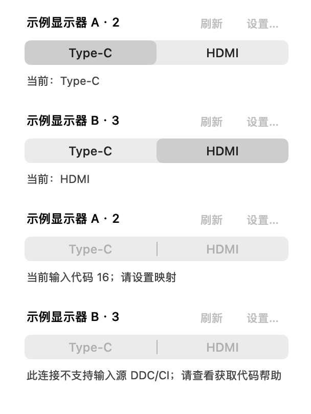
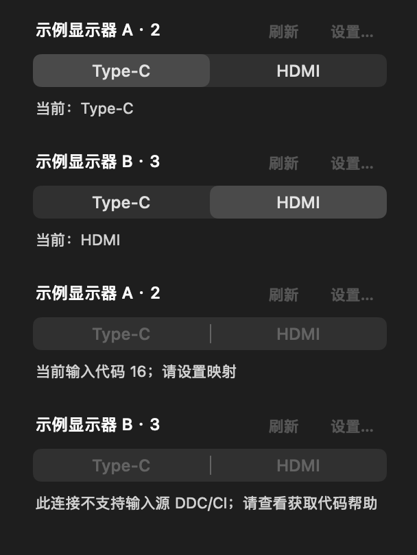
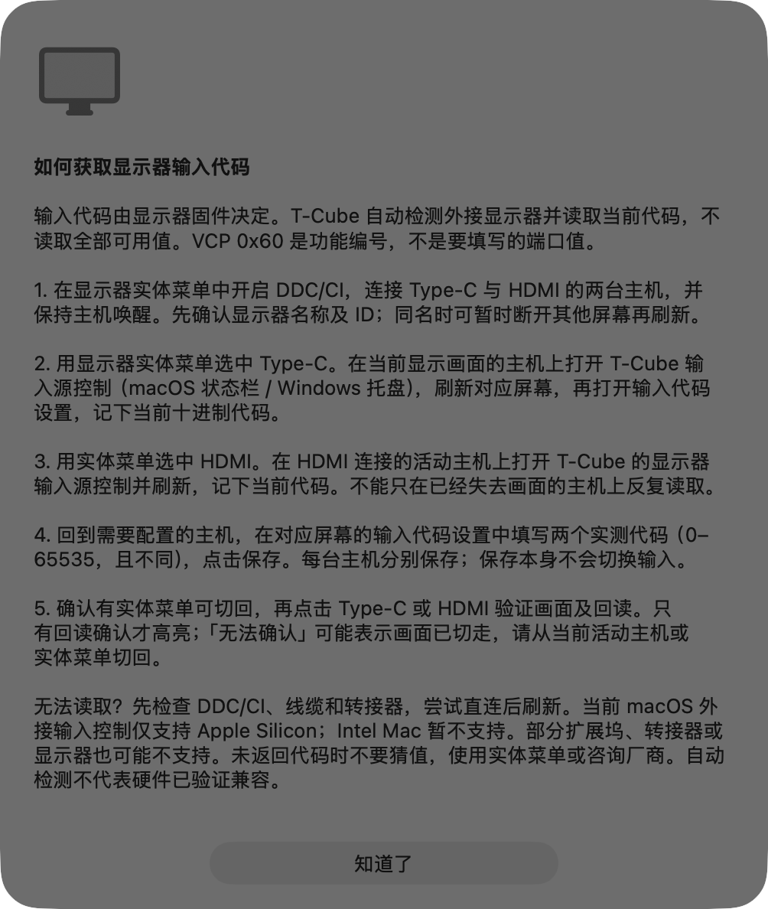
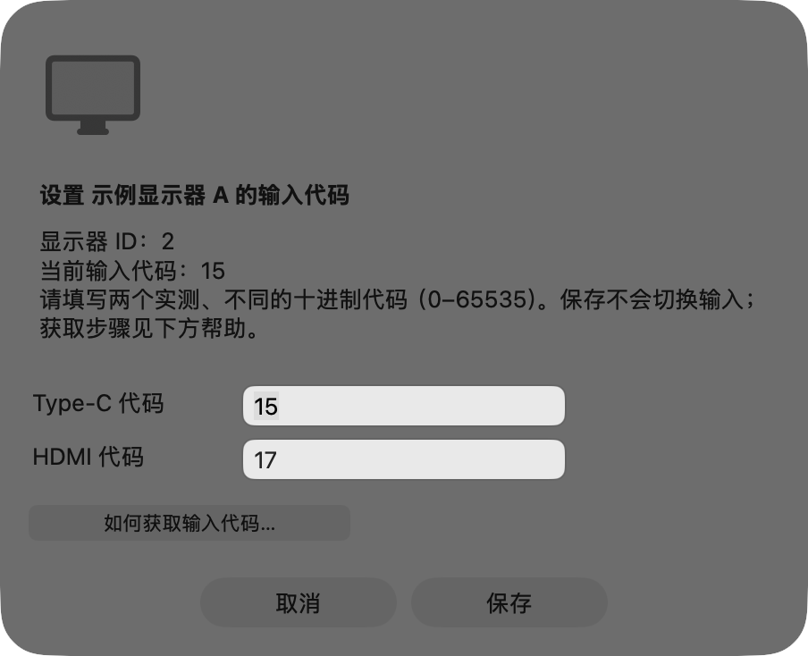
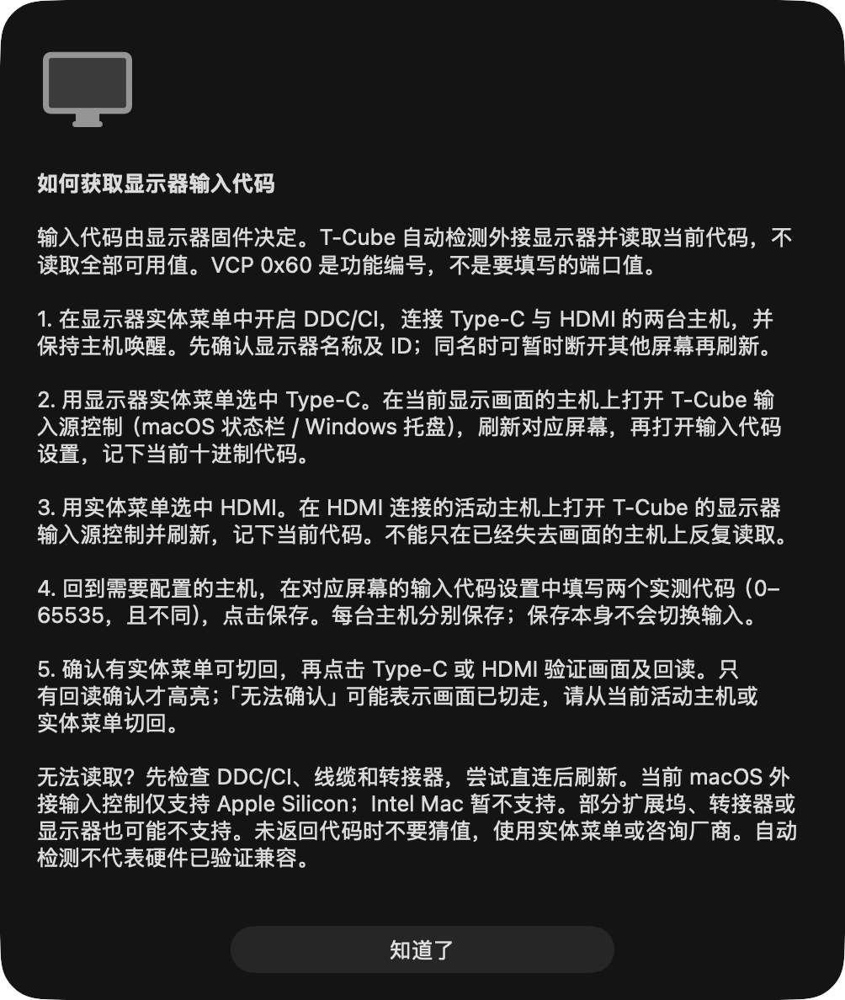
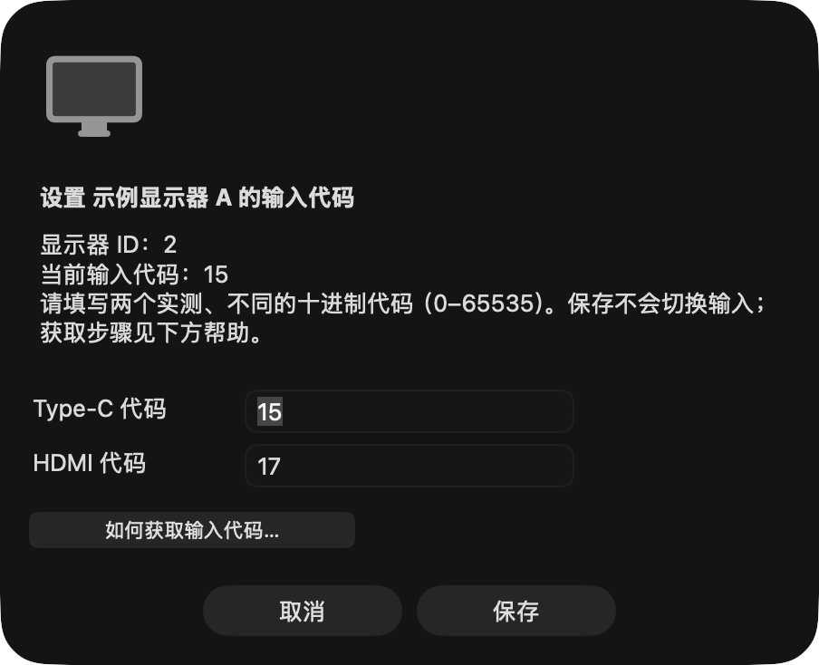
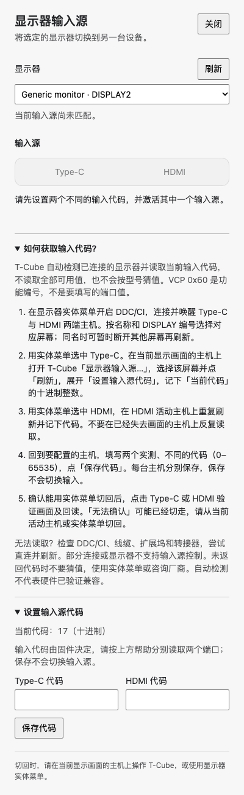
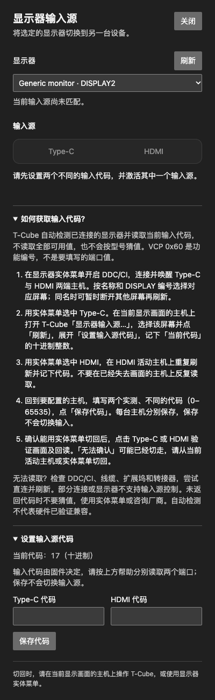

# 显示器自动检测与输入代码帮助

## 根因与实现范围

原实现已经通过 macOS 在线显示器列表和 Windows Win32 显示器接口枚举屏幕，并非只枚举 `27C1U-D`。但两端会按该型号自动套用 `Type-C 7 / HDMI 5`，还提供明显的型号预设入口；身份缺失或有歧义的屏幕被静默过滤，校准说明过于简略。这使其他型号看起来无法识别，也容易将实测个例当成通用端口值。

本次源码变更移除型号判断、自动预设和手工预设按钮。检测到的屏幕与可用的 DDC 输入控制分别处理：身份不唯一、没有物理传输或无法读码的目标仍显示原因，但禁止切换。macOS 仅列外接屏幕；Windows 保留 Win32 枚举到的目标，包括可能没有 DDC 通道的内建屏幕。

每块屏幕仍使用原有稳定身份和独立映射，配置格式未变；读取、重连及取消预设都不会迁移或重写已有 `display-inputs.json`。实际保存过的映射保留；此前仅依赖自动预设、未保存映射的屏幕需要按帮助校准一次，不会自动写入旧预设值。保存前校验目标仍唯一且已连接。macOS 同时核对显示器 ID 与 UUID；Windows 切换时重新枚举并解析完整接口身份、重新获取物理句柄。重复身份不会自动选取第一个目标。Windows 已选屏幕断开后保持空选择，不会自动切到另一块屏幕。

macOS 沿用屏幕参数通知，Windows 沿用显示器变化事件，并在重开面板时刷新；没有新增轮询。取消和代次检查防止旧结果更新重连后的 UI。帮助、刷新、保存配置和拓扑事件不执行输入切换；只有用户明确选择另一端口才请求写入。保存可进行只读检测。

## 帮助流程

macOS 菜单在没有可用外接屏幕时仍提供「如何获取输入代码…」，设置窗口也有帮助按钮。Windows 在实际输入源面板提供可展开的「如何获取输入代码？」。

步骤依据 pixel 在任务 #79588a4c 的独立研究：开启显示器 DDC/CI → 按名称和显示器 ID 确认目标 → 用实体菜单分别激活 Type-C 与 HDMI → 在当前显示画面的主机上刷新 T-Cube 并记录当前十进制代码 → 每台主机分别保存两个实测、不同的 `0–65535` 整数 → 保留实体菜单恢复途径，再验证一次切换及回读。

`VCP 0x60` 是输入选择功能编号，不是端口值。应用读取当前代码，不枚举全部可用值；非连续 VCP 的 `maximum` 未定义，不能据此推断代码范围。本次删除 Windows 界面的最大值显示，并确保未定义的最大值不会拒绝有效当前代码。无法读码时提示检查 DDC/CI、线缆及转接路径，仍不可用则使用实体菜单或询问厂商，不猜测代码。

macOS 外接输入传输目前限 Apple Silicon；Intel Mac 不支持该传输。帮助明确此限制，以及扩展坞、转接器、固件和非活动连接的限制。失去回读时仅显示未确认，不把“请求发送”当成成功，也不自动重试或反向切换。

## 自动化验证

- `env TCUBE_INPUT_PREVIEWS=1 swift test --scratch-path .build/tests --no-parallel --filter DisplayInput`：18 项原生/控制器/硬件测试、3 项核心测试全部通过，包含原生截图导出。编译仍有仓库已有的警告；首次完整编译还报告测试闭包捕获可变数组的警告，不影响通过结果。
- Swift 回归覆盖多块通用屏幕独立映射、不支持 DDC、身份缺失/重复、重连保留配置字节、替换后的过期操作、拓扑变化取消旧结果、损坏配置保护、帮助入口及保存值/空字段保留。
- Windows 使用本机已安装的 Node `22.22.0`（默认 shell 为旧 Node 14，不能运行项目工具链）。`npm run typecheck` 通过；`npm test`：259 项中 256 通过、3 跳过、0 失败。
- Windows 新增“过期/歧义目标保存”用例在修复前失败于 `Missing expected rejection`，修复后通过；相关输入模块 30 项通过、2 项 Windows 硬件/安装环境用例跳过。其余回归覆盖无预设、逐屏读取失败隔离、物理句柄释放、未定义 `maximum`、身份检查及配置字节保留。
- `npm run build` 和 `node --import tsx scripts/display-input-preview.ts` 通过。Chrome 运行真实构建的 renderer，硬件桥接为隔离样本：验证明暗主题、原有输入确认状态、键盘操作、帮助展开、多屏添加、保持已选身份、移除后不回退、后续刷新保持空选择、歧义屏幕禁用保存/切换，且没有页面错误。
- Impeccable detector 对变更的三个 renderer 文件返回 `[]`；`git diff --check` 通过。
- 评审跟进：macOS 帮助原第 2 步把 Type-C 活动主机写成 Mac，现改为当前显示画面的主机，并明确 macOS 状态栏 / Windows 托盘入口；保存步骤也采用平台通用表述，适用于 Mac 接 HDMI、Windows 接 Type-C 的流程。仅修改帮助文案及其明暗截图，控制逻辑未变。重跑 `env TCUBE_INPUT_PREVIEWS=1 swift test --scratch-path .build/tests --no-parallel --filter DisplayInputMenuTests`：5 项通过；两张新帮助截图均已目视检查。

## 原生截图与限制

下图使用当前源码生成的 AppKit 行及真实 `NSAlert` 工厂，示例数据不接触用户配置、不执行硬件写入。Windows 为真实 renderer 在 macOS Chrome 中的隔离截图，不能替代 Windows 原生窗口或安装验证。截图已检查正文、帮助入口、输入字段、明暗主题和状态可读性。

| macOS 多屏状态（浅色） | macOS 多屏状态（深色） |
| --- | --- |
|  |  |

| macOS 获取代码帮助 | macOS 设置与帮助按钮 |
| --- | --- |
|  |  |
|  |  |

| Windows 帮助（浅色） | Windows 帮助（深色） |
| --- | --- |
|  |  |

本次没有主动切换任何实体显示器，也没有新增其他型号、连接路径或 Intel Mac 的硬件兼容性证据。既有 `27C1U-D` 实测记录只适用于当时的设备与连接，不能推导其他硬件兼容。最终集成、全量原生验收、备份用户 JSON、安装到 `/Applications/T-Cube.app`、核对可执行文件哈希和可用的桌面检查，由任务 #36db1fc5 单独记录；本文不宣称这些步骤已经完成，也不宣称安装包已发布。
