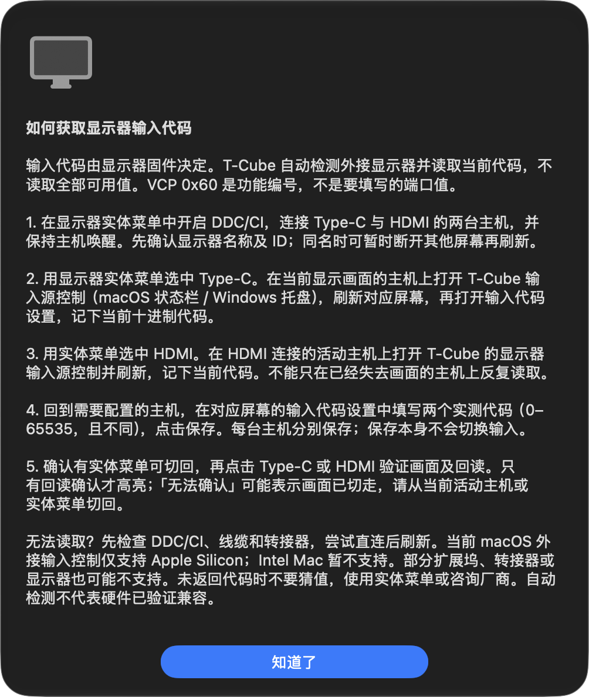
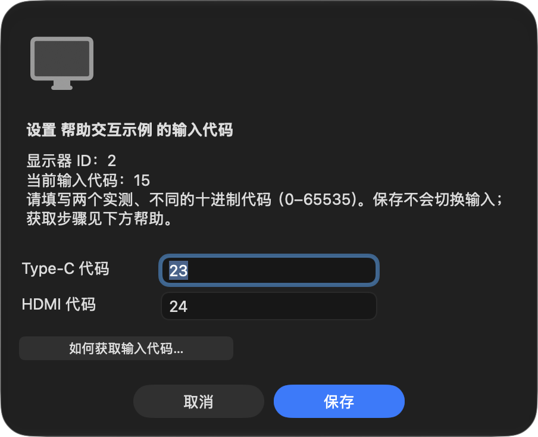

# 输入代码设置内帮助即时显示

## 根因与修复

用户报告在输入代码设置中点击帮助，需要关闭设置后才显示说明。原生交互回归复现了同一顺序：设置仍打开时，没有新帮助模态窗口；关闭设置后，排队的帮助才出现。因此，本次确认的原因是调度延迟，而非一个已经显示的帮助窗口被设置遮挡。

生产路径中，菜单行关闭菜单后以 `DispatchQueue.main.async` 进入设置的 `NSAlert.runModal()`；帮助按钮又向同一主队列提交新的 `runModal()`。外层设置回调尚未返回，新的主队列回调无法在其中重入，帮助只能等设置关闭后执行。

修复仅在设置帮助按钮的回调内直接运行帮助的嵌套原生模态窗口，移除多余的菜单取消与异步排队。帮助关闭后继续原设置模态循环，沿用同一视图和字段。没有恢复独立菜单帮助行，没有改变显示器控制、配置格式或硬件支持范围。

## 真实原生交互回归

`Tests/TCubeTests/DisplayInputHelpInteractionTests.swift` 使用同步 XCTest，在原生 `NSMenu` 中触发实际设置按钮，经过生产的主队列设置回调进入真实 `NSAlert`，再触发帮助和关闭按钮。临时配置与样本硬件隔离用户数据，硬件写入次数必须为零；不是仅验证 alert 工厂或字符串。

两项用例分别覆盖取消和保存，每项均执行两次帮助往返：

- 设置打开后填写未保存值 `23/24`（仅为测试样本，不是端口建议值）。
- 点击帮助时，设置仍可见，新的帮助窗口成为可见、接收键盘焦点的当前模态窗口。
- 关闭帮助后，原设置恢复模态和焦点，字段保持 `23/24`。
- 再次打开、关闭帮助，取消保留原有 `15/17` 映射，保存才持久化 `23/24`。
- 设置关闭后继续运行事件循环，检查没有积压帮助，且整个流程没有输入切换写入。

命令与结果：

```bash
# 实际原生交互及可选截图导出
env TCUBE_HELP_INTERACTION_PREVIEWS=1 swift test --scratch-path .build/tests --no-parallel --filter DisplayInputHelpInteractionTests

# 输入源相关完整回归（不启用预览导出）
swift test --scratch-path .build/tests --no-parallel --filter DisplayInput

git diff --check
```

第一条命令：2 项交互测试通过，零失败。最终测试驱动稳定后，还临时恢复旧异步实现再运行相同交互测试：2 项均失败，分别记录“设置仍打开时帮助未成为可见模态”和“关闭设置后排队帮助才出现”，共 6 条预期失败断言，进程正常退出 `1`。恢复修复后第二条命令退出 `0`：XCTest 2 项通过、1 项预览跳过；原生 Swift Testing 16 项通过、1 项预览跳过；核心 3 项通过，总计 21 通过、2 跳过。空白检查通过。

CLI 测试进程以可接收焦点的原生宿主模拟前台菜单交互，焦点断言保留。模态停止后测试主动投递唤醒事件，确保失败清理也能退出 AppKit 事件等待；这只属于测试驱动，不是产品补丁。

## 当前原生证据

下图由通过的真实交互用例导出，已目视核对。对应窗口状态见 [事件记录](display-input-help-interaction-events.json)：三阶段窗口均可见且为 key window；帮助阶段 `modalIsSetup` 为 `false`，但 `setupVisible` 仍为 `true`；返回阶段 `modalIsSetup` 恢复 `true`。仅捕获测试窗口，不包含桌面全屏内容。

| 设置内填写未保存值 | 点击后帮助即时显示 | 关闭帮助返回原设置 |
| --- | --- | --- |
|  |  |  |

这是自动化原生按钮和嵌套模态回归，不是维护者手工桌面点击，也不是实体显示器兼容性或输入切换测试。本次没有修改用户 JSON、安装应用或发布安装包。安装验收仍由任务 #d4437f24 在菜单入口删减和本修复均获评审批准后统一进行。
