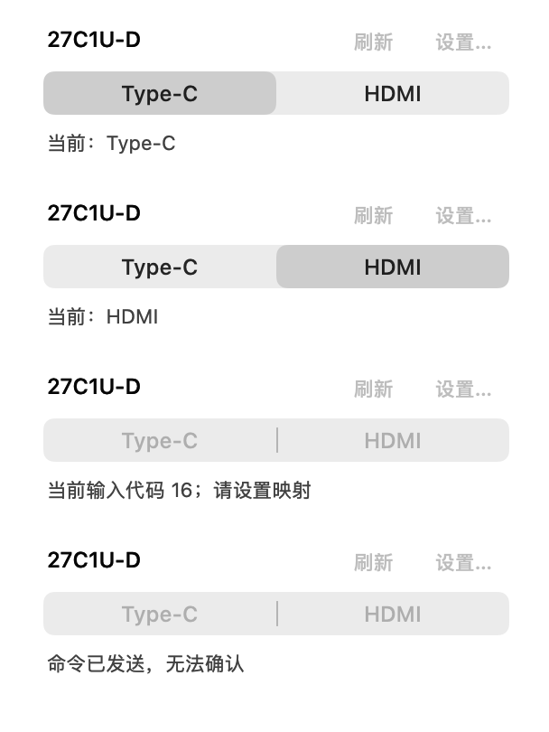
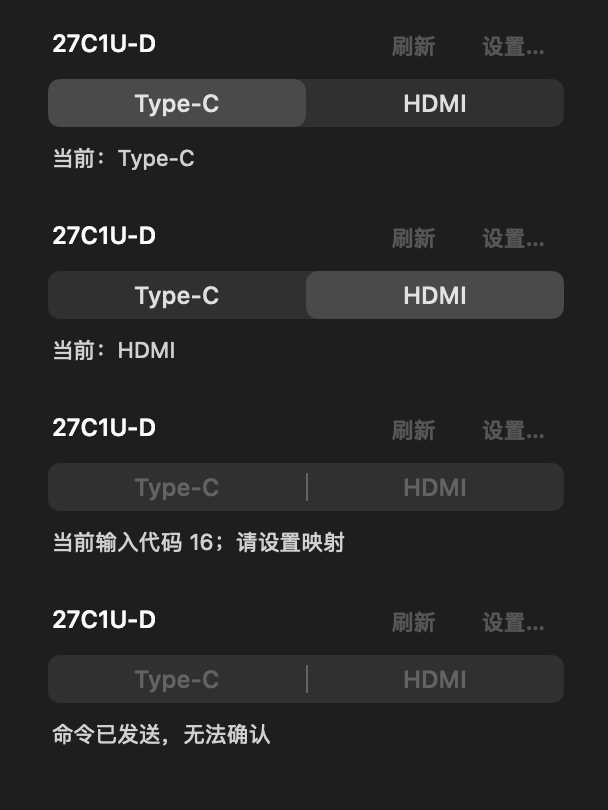
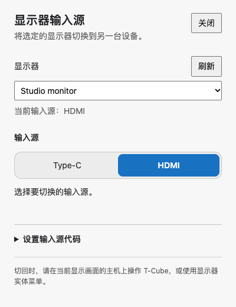
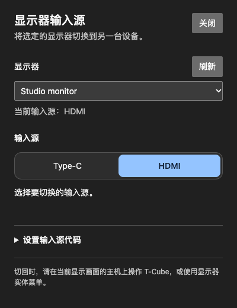
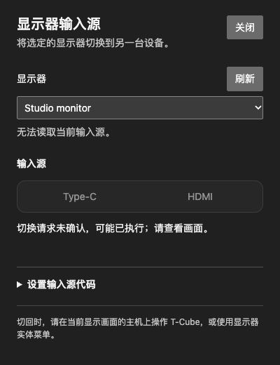

# Two-segment display-input switches — 0.22.3

## Behavior

Both platforms replace the Type-C/HDMI slider with two explicit click targets: Type-C on the left, HDMI on the right. macOS uses a native AppKit segmented control; Windows uses a native HTML radio group with a short compositor selection transition and a Reduce Motion alternative. System light/dark appearance, keyboard operation and accessibility labels are retained. No dependency, timer, polling, configuration migration or new display-control privilege was added.

A click requests a port without optimistically claiming hardware success. The last confirmed selection remains while busy; controls disable until the result. Confirmed/no-op readback selects the actual input. Not-applied readback preserves the actual input; unknown or sent-unconfirmed results clear both selections. Selecting the active port does not write again. DDC transport, calibration, presets, identity checks and inactive-input limitations are unchanged. Physical monitor tests and measured port codes remain documented in the [original input-switch verification](2026-11-05-display-input.md).

## Verification

- `swift test --scratch-path .build/tests --no-parallel`: passed. XCTest reported 13 tests with one opt-in export skipped; Swift Testing reported 182 TCube and 133 CubeCore tests, zero failures, with declared hardware/preview checks skipped.
- `env TCUBE_INPUT_PREVIEWS=1 swift test --scratch-path .build/tests --no-parallel --filter DisplayInputMenuTests`: all three passed, including native light/dark row export. New segmented-control expectations failed against the old slider before implementation.
- Windows local tests: 254 passed, three platform/installer-only cases skipped; TypeScript check and renderer/app build passed. The shell default Node 14 cannot run this project's tooling; checks used the available Node 24.22.1 runtime, within the declared Node >=22.12 range.
- `node --import tsx scripts/display-input-preview.ts` against the built renderer: passed on this Mac's installed Chrome. Fixtures replace only the external hardware bridge and never read user files or open a native driver. They cover clicks, both arrow-key directions, active-port no-op, busy duplicate prevention, confirmed/no-op/not-applied/unconfirmed readback, exclusive/cleared selection, Reduce Motion and both themes. The new radio-group expectation failed against the original range input before implementation. Screenshot captures settle CSS transitions for endpoint comparison.
- Impeccable detector over the three changed web renderer targets returned no findings. Native and web exports were visually inspected.
- Independent code review found no blockers.
- `bash scripts/build-app.sh`, `bash scripts/build-dmg.sh`, `bash scripts/verify-dmg.sh` and `git diff --check`: passed.

## Local installation and limits

Installed `/Applications/T-Cube.app` 0.22.3 build 45 after normal quit. Previous applications and all existing user JSON before/after quit are preserved in ignored `build/install-backups/0.22.3/20261107-000535/`. Before/after JSON hashes matched; no fixtures replaced user configuration. The installed process was observed running, and its executable hash and signature match the release build.

Executable SHA256: `dc4fdbdac69f5fd69863fb19b409281f74acfe82ea9741eada95b7c16086ba11`.

Manual installed-menu clicking could not be completed: the desktop-control tool failed twice with `Sky Computer Use native pipe startup failed`, including after a runtime reset. Installation/process checks, native control action tests and rendered previews are automated checks, not a claim of manual desktop acceptance. No physical monitor input switch was performed for this UI-only change, and no manual maintainer-PC Windows check is claimed.

## Captures

| macOS light | macOS dark |
| --- | --- |
|  |  |

| Windows light | Windows dark |
| --- | --- |
|  |  |

## Release workflows

Packaged source: `b5d0b5dbdb60e60095e9889be2d0e097cb9a05b0`.

- [Source client CI](https://github.com/gd0306/t-cube/actions/runs/42249527677): passed.
- [Windows installer and installed-app acceptance](https://github.com/gd0306/t-cube/actions/runs/42249541419): passed.
