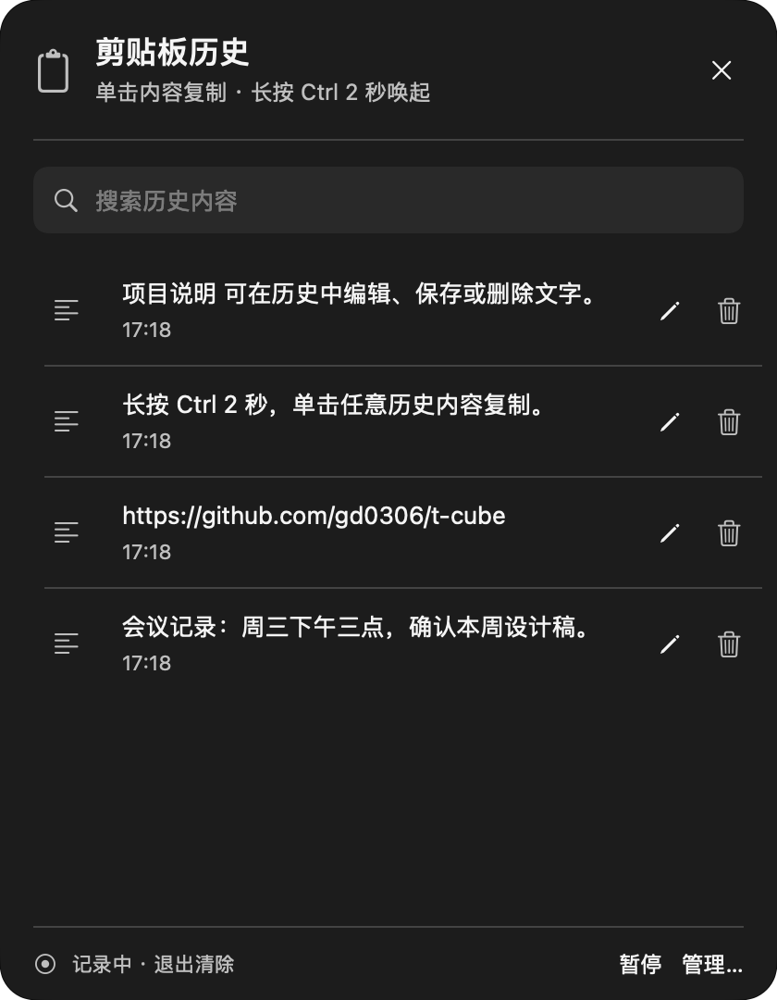
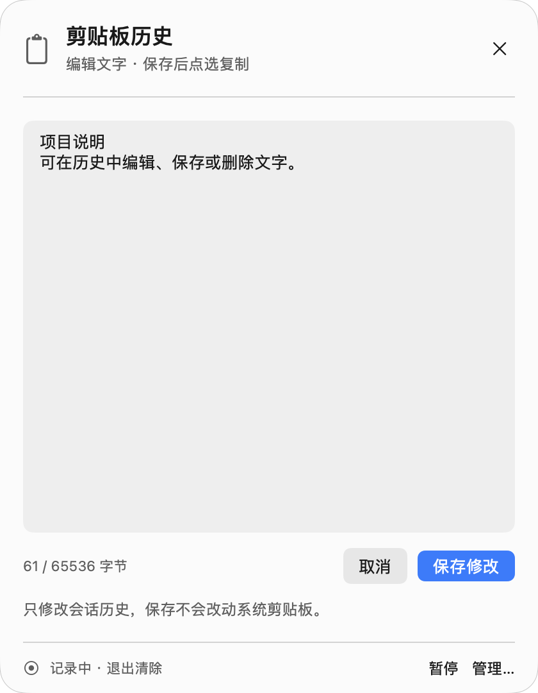
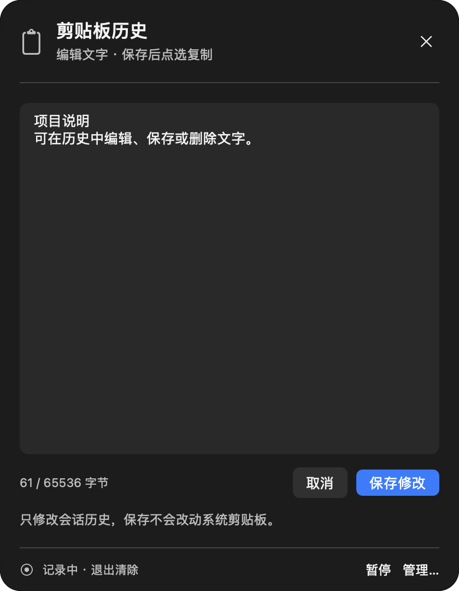
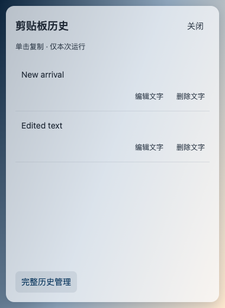
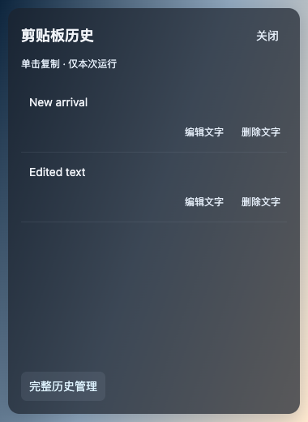

# Ctrl 长按剪贴板快捷面板验证

> 本文记录首轮功能初验。当前 `0.22.5` 的默认记录、开机自启和两秒计时更新见[后续验收记录](2026-11-10-0.22.5-defaults.md)。

## 行为与边界

- macOS / Windows 单独长按 `Ctrl` 2 秒，在鼠标所在显示器的可用范围内打开快捷历史列表。松开 Ctrl 后保留，单击文字或图片复制并收起；点击外部可收起。
- 本轮发生其他按键、鼠标按钮或滚轮操作时取消；鼠标移动不会取消。每次按住只触发一次，启动时已按住、休眠或会话切换后需要释放并重新按住。
- 文字支持编辑、保存、取消和删除；图片支持复制和删除。编辑保留记录 ID、时间和顺序，只修改会话历史，不写系统剪贴板。空白、NUL、单条超过 64 KiB 或总文字超过 2 MiB 的修改被拒绝，不驱逐其他记录。
- 普通新记录不覆盖草稿；删除或清空源记录会同步释放其编辑草稿。复制复用现有自身写入抑制，不新增重复历史。
- 首轮初验版本每次启动默认暂停记录，快捷面板提供明确的「启用记录」。原有记录限制、敏感类型排除、内存保存和退出清除边界保持不变。
- 保留原有完整内容管理窗口、Ctrl 临时恢复尺寸和 Ctrl 拖动。快捷窗口不能获取常用内容库等无关 IPC 权限。
- macOS 26+ 使用 `NSGlassEffectView` 的 Clear 样式，macOS 15 回退系统材质。Windows 11 22H2+ 使用原生 acrylic；不支持原生背景材质的系统使用透明着色回退。辅助功能减少透明度／高对比偏好采用可读性回退。

## 自动化验证

```bash
env TCUBE_CLIPBOARD_PREVIEWS=1 swift test --scratch-path .build/tests --no-parallel
swift test --scratch-path .build/tests --no-parallel --filter EdgeDockAnimationTests
env TCUBE_CLIPBOARD_PREVIEWS=1 swift test --scratch-path .build/tests --no-parallel --skip DisplayInputHelpInteractionTests
swift test --scratch-path .build/tests --no-parallel --filter DisplayInputHelpInteractionTests
bash scripts/build-app.sh --debug
git diff --check
```

- 新增纯状态机、macOS 采样适配器和剪贴板编辑／快捷窗口回归，包含两秒阈值、按住只触发一次、采样间隙、瞬时组合、事件先后顺序、休眠通知、草稿清理、复制与自身写入抑制、负坐标显示器约束。
- 未拆分的全量串行运行仍失败：`EdgeDockAnimationTests.testCompletedTransitionsDetachTheRendererAndReuseOneOverlay` 在同进程完整 XCTest 顺序中报告 6 个断言失败。其余 XCTest 以及 197 项原生 Swift Testing、138 项 CubeCore Swift Testing 通过（包含声明的可选跳过项）。该动画测试独立运行通过，6 个 XCTest 中 1 个可选跳过。
- 这与[既有发布验证记录](2026-11-08-release-consistency.md)中的同一测试顺序问题一致。动画实现与断言未修改；拆分结果不能替代或改称全量绿色。
- 拆分运行通过：跳过帮助交互类的独立进程为 14 项 XCTest（2 项可选跳过）、197 项原生 Swift Testing 和 138 项 CubeCore；帮助交互类随后在另一进程独立运行，2 项 XCTest 通过。最终相关聚焦复测为 13 项原生测试及 11 项核心测试通过。
- Windows 使用项目要求的 Node.js 22+，`npm test` 为 269 项：266 通过、3 项 Windows 原生环境跳过；`npm run typecheck`、`npm run build` 及相关聚焦测试通过。
- 提交 `76491c8cc4117ea67e89c8049ea8d8c27a4fee3e` 的[原生功能 CI](https://github.com/gd0306/t-cube/actions/runs/42831276112) 在 Windows 2022 / 2025 均通过。`clipboard-quick-smoke.ts` 在原有自有接收器和剪贴板快照保护内使用真实 `SendInput`：短按不唤起；长按分别在 2334 / 2303 ms 后显示实际快捷窗口，释放 Ctrl 后保持显示；通过快捷 UI 编辑和保存，记录 ID／时间／顺序及系统剪贴板均保持预期；单击复制后收起，超过两轮录制周期仍未重复录入，也未向接收器输入内容。这是 Windows 系统级自动化输入验收，不是人工物理键盘验收。
- 首次接入该原生验收时，测试 Node 进程受 Windows 前台锁限制，未能激活自有接收器；Ctrl 尚未发送便失败。修正仅涉及测试：由当前前台 Electron 主进程独立验证 PID／子窗口所有权后转移前台，再隐藏旧窗口，仍要求实际前台确认后才能输入。未增加强制线程附加、任意点击或测试后门，未改变生产功能来放宽断言。
- 代码提交 `c23e66847bb7c50d08bfc1fe0816f64e760765fe` 的 [Windows source CI](https://github.com/gd0306/t-cube/actions/runs/42790543103) 最终两个 runner 均通过，包括隔离安装及运行已安装应用；CI 单元测试为 267 通过、2 项跳过。Windows 2022 首次运行在既有“字段粘贴追加到自有接收器”断言失败，诊断显示两次捕获与输入批次均已发出；同一 SHA 不改代码、只重跑失败 job 后通过。首次失败不能作为新长按功能的通过证据，也未据此修改粘贴行为或放宽断言。
- `windows/scripts/clipboard-quick-ui.ts` 在 Chromium 中运行生产渲染器和实际 Recorder 操作，验证编辑取消／保存、无效修改后的焦点、录入时草稿保留、复制失败不关闭、文字与图片复制／删除。
- `windows/scripts/clipboard-quick-electron.ts` 在隔离临时数据目录启动生产 DesktopApplication / OfficeServices，验证暂停空态、快捷窗口 IPC 权限拒绝、Esc 隐藏、重开仍暂停和跳转完整历史。此流程不读取或写入系统剪贴板。
- Windows 原生 Raw Input 投递、物理键鼠、实际 acrylic 和旧系统透明回退仍需要 Windows 桌面验收。本机的 Electron / Chromium 检查不能证明这些原生效果。

Windows 自动化命令（在 `windows/` 目录，Node.js 22+）：

```bash
npm test
npm run typecheck
npm run build
node --import tsx scripts/clipboard-quick-ui.ts
node --import tsx scripts/desktop-clipboard-ui.ts
node --import tsx scripts/clipboard-quick-electron.ts
# Windows 桌面或 CI：包含自有窗口中的原生 Ctrl 长按验收
npm run smoke
```

## 原生预览

以下图片来自本机实际 AppKit / SwiftUI 快捷窗口，用独立命名剪贴板和示例文字生成；未读取真实剪贴板或写入用户配置。原生视图缓存截图用于检查排版、前景对比和编辑状态，不能单独证明桌面合成器的背景折射或模糊效果。

<p></p>

<p></p>

以下是 Windows 生产渲染器在 Chromium 中、叠加自有测试背景的浅深预览，用于检查透明着色层与文字对比；不代表 Windows 原生 acrylic 的桌面效果。

<p></p>

## 桌面验证限制

本次桌面自动化入口返回 `Sky Computer Use native pipe startup failed` 和 `The browser access host is unavailable`。没有通过该工具执行物理长按或鼠标手动验收；原生测试、应用构建和本地安装检查需与人工桌面验证区分。

## 本机安装验收

- 正常退出已有的 `/Applications/T-Cube.app`，将旧应用及 5 个用户 JSON 备份到忽略目录 `build/install-backups/ctrl-clipboard/20261110-171849/`。该目录包含私人数据，不可提交或发布。
- 安装本次 debug 构建，`codesign --verify --deep --strict /Applications/T-Cube.app` 通过；已从安装位置重新启动，进程路径正确。
- 构建与安装后的可执行文件 SHA-256 均为 `9996528151372bddb17ca54dda67efc8f0f170d5b193cc83da0d6801596d4b41`。
- 安装前及重新启动后，5 个用户 JSON 均逐字节一致。未把预览／测试数据写入真实配置或真实剪贴板。
- 首轮功能初验的应用版本为 `0.22.4`，本次为本地功能验证构建；没有重新发布安装包，已发布安装包仍不含此功能。
