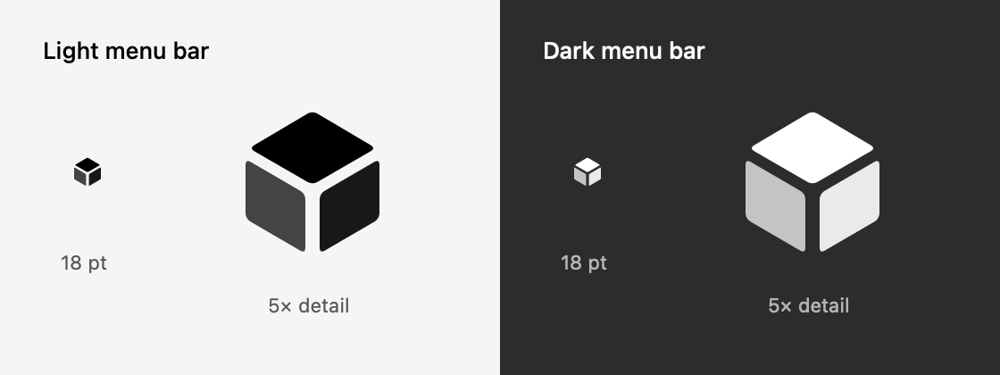

# 0.22.7 macOS 菜单栏图标

## 设计与实现

- 参考已批准的应用图标，提炼三块圆角立方面与 Y 形留白；区别于用户参考图的细线框与侧面镂空。顶面、左右面使用轻微不同的遮罩透明度，保持小尺寸下的立体辨识。
- `StatusItemIcon.make()` 使用 AppKit 矢量绘制，逻辑尺寸 18 × 18 pt，`isTemplate = true`，由系统适配菜单栏颜色；没有彩色底板、图片缩小采样或外部资源依赖。
- 替换状态栏原 `cube.transparent` 系统符号；保留菜单、工具提示、辅助功能名称及状态项位置标识。

这是使用生产图标工厂生成的原生矢量预览，颜色由预览画布模拟模板着色，不是菜单栏屏幕截图。

## 自动化与本机验收

- Swift 6 独立编译生产图标工厂，导出 1×／2×／3× 遮罩及浅深色预览，检查透明角落、模板属性、18pt 尺寸并查看实际原尺寸效果。此可逆视觉改动没有新增镜像绘制实现的单元测试。
- `StatusMenuLayoutTests`、`DisplayBrightnessMenuTests`、`DisplayInputMenuTests` 共 10 项通过；正式构建、签名深度／严格检查、DMG 校验及挂载内容核对通过。
- macOS `0.22.7` build `50` 正常替换到 `/Applications/T-Cube.app` 并从该位置启动；构建／安装可执行文件 SHA-256 为 `7a2b405c90cfdbcd9e98c0f4f40fa0e1b364eb79b384fc87acc34d22c21c5132`。
- 旧应用、5 个用户 JSON 和 UserDefaults 保存在忽略目录 `build/install-backups/0.22.7/20261111-174618/`。安装替换时 JSON 字节一致；启动后观察到 `configuration.json` 的 `windowPosition` 更新，其余配置内容及另外 4 个 JSON 保持不变；新旧坐标均在当前显示器可用范围。没有手动移动窗口或用测试数据覆盖入口、外观，未将旧位置回写到用户当前运行的布局。
- 桌面自动化入口仍返回 `Sky Computer Use native pipe startup failed` 和 `The browser access host is unavailable`，因此没有声称通过工具手动点击了已安装图标或验收实际菜单栏着色。

正式双平台安装包与公开下载验收在发布后追加。
