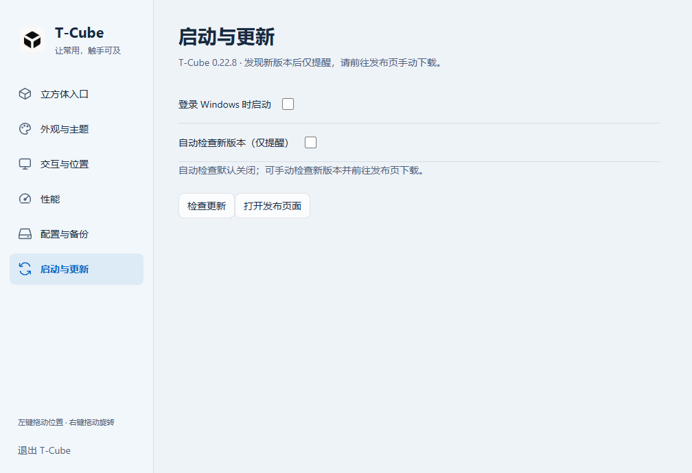

# 0.22.8 设置界面与 Windows 托盘图标

## 变更与验证范围

- macOS：五类侧栏导航、原生 NSVisualEffectView 背景、透明标题栏；隐藏页退出键盘及辅助功能访问。外观设置立即保存，默认恢复只影响本页字段。
- Windows：六类侧栏导航、统一标题和设置分组、系统深浅色；Windows 11 22H2+ 使用 Electron 原生 Acrylic，旧系统／减少透明度／高对比度使用实色回退。
- Windows 外观本来就是即时保存，此次保留并增加仅重置外观材质、颜色、光效及轮换的默认恢复。入口、交互参数与位置不受该按钮影响。
- Windows 托盘改用蓝青三面立方体，有浅色外轮廓与深蓝细分面线。Windows 加载 16–256px 多分辨率 ICO，开发预览使用同源 PNG；生成脚本为 `windows/scripts/make-tray-icon.py`（需要 Pillow）。没有修改 macOS 的系统模板菜单栏图标。
- 生产版设置渲染器的隔离预览覆盖六页、800／1060px、深浅色、无横向溢出、键盘导航、高对比度、即时保存与默认恢复边界。

下面是当前生产 HTML/CSS/JS 在隔离配置下的真实渲染；不是原生 Windows 桌面截图，不用于证明 Acrylic 背景或托盘位置的实际视觉效果。采集脚本：`windows/scripts/settings-preview.ts`。

## 本地自动化

- Node 22.19.0：Windows 类型检查通过；282 项单元测试，279 通过、3 项平台相关跳过。
- macOS 完整测试与已知同进程动画断言边界见 [设置设计与本机记录](../design/2026-11-12-macos-settings.md)。未降低测试断言或将隔离通过冒充全量通过。
- 正式安装后的 Windows 烟测增加六类导航、即时材质保存、默认恢复范围及包内彩色托盘 PNG／多分辨率 ICO 检查。

## 发布验收

- 两个平台打包源码：`14e26bd70cc94eea8744e052d01c9cd38f89a642`。后续 README／验收记录提交仅更新文档，不改变包内应用源码。
- [Windows 源码 CI](https://github.com/gd0306/t-cube/actions/runs/43237905782)：Windows 2022／2025 两个环境的类型检查、单元测试、构建、隔离安装及实际输入验收均通过。
- [Windows 正式安装包 CI](https://github.com/gd0306/t-cube/actions/runs/43237942922)：x64 NSIS 制作、实际安装、独立原生显示器 worker 检查及 28 项安装应用烟测通过。包括新版设置与包内彩色托盘图标检查。
- 初轮 `000267c` 的新增测试尝试在 Electron evaluate 内动态导入 Node 模块，受测试执行环境限制失败；`14e26bd` 将资源读取移到测试宿主进程后，以上全部 CI 通过。未改产品代码绕过验收。
- macOS `0.22.8` build `51` 已正式构建并通过 DMG 挂载、包内应用、可执行文件、深度严格签名、Applications 链接与安装说明核验。
- 正常退出后备份旧应用、4 个用户 JSON 及 UserDefaults 至忽略目录 `build/install-backups/0.22.8/20261112-222918/`，随后安装并启动 `/Applications/T-Cube.app`。通过原生桌面操作打开新设置及启动更新页，确认显示 `0.22.8`；安装／构建可执行文件 SHA-256 均为 `a19bd7e65b9acb452ae179f0d3f63faa64672d77409d41b882c9a5eb68dfdbfa`。
- 安装前后 4 个用户 JSON 字节一致；启动后配置按 face 规范化比较也无字段变化，另外 3 个 JSON 保持逐字节一致。没有测试数据覆盖用户入口或内容。
- 发布前聚焦回归：2 项显示器帮助交互 XCTest 及 4 项外观／菜单 Swift Testing 均通过。既有完整同进程边缘动画断言失败仍如上记录。
- 没有在维护者的 Windows 桌面人工验收原生 Acrylic 或任务栏托盘视觉；macOS 尚未逐项切换浅色／减少透明度做人工检查。
- macOS 为 ad-hoc 签名、未公证；Windows 安装器未 Authenticode 签名，沿用现有签名边界。

下面是构建机实际安装 NSIS 后采集的设置页，使用隔离测试数据；可确认安装版本和设置布局，不代表 Windows 11 桌面背景模糊或任务栏托盘的人工验收。

## 公开附件

[v0.22.8](https://github.com/gd0306/t-cube/releases/tag/v0.22.8) 已设为最新稳定版；标签、包内源码标记与工作流提交均指向 `14e26bd70cc94eea8744e052d01c9cd38f89a642`。

| 文件 | 字节 | SHA-256 |
| --- | ---: | --- |
| `SHA256SUMS.txt` | 198 | `bfebe5afdd842c2701ce712510c49af242429ff32dfddfcafb4264da27f507d7` |
| `SOURCE_COMMIT.txt` | 41 | `1da74479a668d56d07ca41b8092f723ef8cd883812aa48138178b05a5cc3f355` |
| `T-Cube-0.22.8-macos-arm64.dmg` | 4097504 | `3f608612b0b6ede9ab254d8f09ef1601cee97844f4784484656c093b86333d4f` |
| `T-Cube-0.22.8-windows-x64-setup.exe` | 125840114 | `4d090cf6d4ad1a996575179385429b9f534a32e3415796ef6ec8af7cea4ee7d8` |

GitHub 附件元数据的大小及 SHA-256 与本地产物逐项一致。Windows 构建机 282 项单元测试中 280 通过、2 项平台／选择性测试跳过；另以实际安装路径独立执行的原生 worker 测试通过。

四个附件均已通过不带认证信息的公开 URL 实际下载，下载字节数和 SHA-256 与本地逐项一致；`SOURCE_COMMIT.txt` 与标签提交一致，GitHub latest 指向 `v0.22.8`。根中英文 README 和 Windows README 已同步到实际公开文件。
