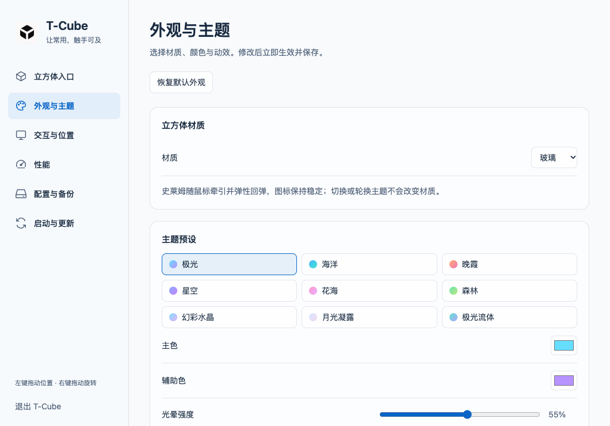
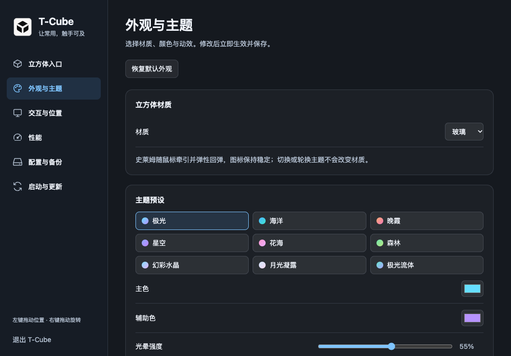

# 0.22.8 设置界面与 Windows 托盘图标

## 变更与验证范围

- macOS：五类侧栏导航、原生 NSVisualEffectView 背景、透明标题栏；隐藏页退出键盘及辅助功能访问。外观设置立即保存，默认恢复只影响本页字段。
- Windows：六类侧栏导航、统一标题和设置分组、系统深浅色；Windows 11 22H2+ 使用 Electron 原生 Acrylic，旧系统／减少透明度／高对比度使用实色回退。
- Windows 外观本来就是即时保存，此次保留并增加仅重置外观材质、颜色、光效及轮换的默认恢复。入口、交互参数与位置不受该按钮影响。
- Windows 托盘改用蓝青三面立方体，有浅色外轮廓与深蓝细分面线。Windows 加载 16–256px 多分辨率 ICO，开发预览使用同源 PNG；生成脚本为 `windows/scripts/make-tray-icon.py`（需要 Pillow）。没有修改 macOS 的系统模板菜单栏图标。
- 生产版设置渲染器的隔离预览覆盖六页、800／1060px、深浅色、无横向溢出、键盘导航、高对比度、即时保存与默认恢复边界。

下面是当前生产 HTML/CSS/JS 在隔离配置下的真实渲染；不是原生 Windows 桌面截图，不用于证明 Acrylic 背景或托盘位置的实际视觉效果。采集脚本：`windows/scripts/settings-preview.ts`。

## 本地自动化

- Node 22.19.0：Windows 类型检查通过；282 项单元测试，279 通过、3 项平台相关跳过。
- macOS 完整测试与已知同进程动画断言边界见 [设置设计与本机记录](../design/2026-11-12-macos-settings.md)。未降低测试断言或将隔离通过冒充全量通过。
- 正式安装后的 Windows 烟测增加六类导航、即时材质保存、默认恢复范围及包内彩色托盘 PNG／多分辨率 ICO 检查。

## 发布验收

以最终追加的提交、构建机、安装与公开附件核验结果为准。
