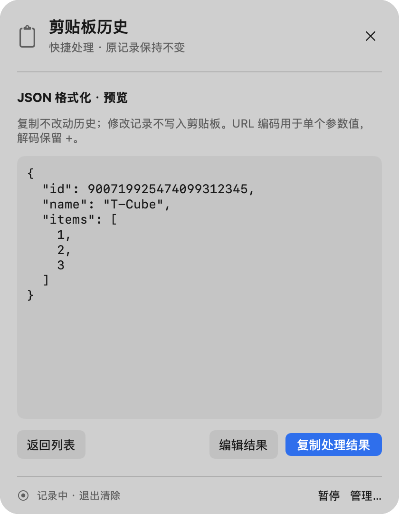
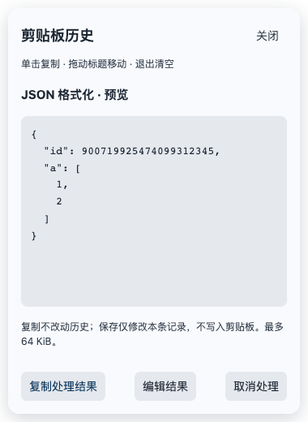
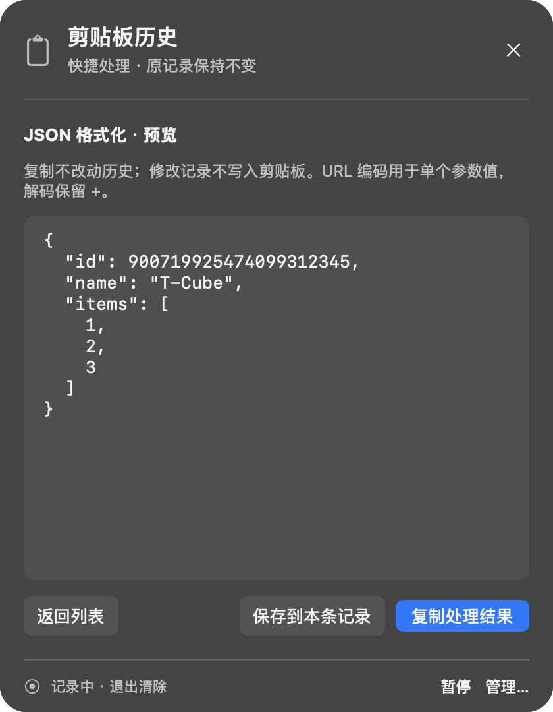
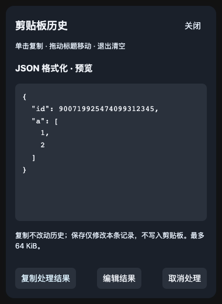

# 剪贴板逐条文字处理

此功能随 `0.22.9` 双平台安装包发布，最终发布验收见[0.22.9 记录](2026-11-13-clipboard-release.md)。下文保留开发阶段验证记录。本次没有接入 AI 或发送剪贴板内容到网络。

## 最终交互

- macOS 的文字记录右侧增加文字处理菜单，与编辑、删除并列；Windows 每条文字记录右侧增加“处理…”原生下拉菜单。
- Ctrl 快捷面板和完整历史管理均可使用；图片记录不显示文字工具。
- 全部操作先生成预览：原文（纯文本）、去除每行首尾空白、合并连续空行、大小写转换、JSON 格式化／压缩、URL 编解码。
- 选择菜单项不会复制，也不会修改历史。用户可直接复制结果，或选择“编辑结果”自行调整，再复制或明确“保存到本条记录”。
- 复制结果不修改历史；保存只修改本次运行的这条记录，保留 ID、时间与列表位置，不改系统剪贴板。
- 取消不修改原文。原记录修改、删除或清空时，失效预览／草稿释放；Windows 主进程同时校验预览来源，防止覆盖已变化的记录。
- macOS 完整历史沿用现有复制／粘贴／保存常用内容回调，确认操作之前不写剪贴板。

## 数据处理

- 规则处理全部本地完成，无新依赖、API key、网络请求或配置格式变更。
- JSON 使用有界的词法／语法格式化，只修改标记之间的空白；保留原数值、重复键、顺序和转义形式，避免大整数被浮点序列化改写。支持根标量，嵌套上限 128 层。
- URL 编码针对单个参数值，采用 UTF-8 与 RFC 3986 未保留字符；解码不把 `+` 当空格。坏百分号、无效 UTF-8、空字符、空结果和超过 64 KiB 的输出均拒绝，不截断结果。
- 继续使用会话历史既有的单条 64 KiB／总计 2 MiB 限制和自写剪贴板抑制机制。处理不会把历史自动持久化。

## 界面预览

macOS 图片是生产 SwiftUI 控件在独立命名剪贴板中的原生渲染；Windows 图片是生产渲染器在隔离宿主下的浏览器渲染。使用合成文本，没有读取用户历史。Windows 预览不代表 Windows 桌面或系统剪贴板的人工验收。

| macOS 预览 | Windows 预览 |
| --- | --- |
|  |  |
|  |  |

复现：`TCUBE_CLIPBOARD_PREVIEWS=1 swift test --scratch-path .build/tests --no-parallel --filter ClipboardQuickPreviewTests`；Windows 构建后 `node --import tsx scripts/clipboard-text-preview.ts`。

## 验证

- 两端先增加失败测试，再实现处理核心与主进程路由；覆盖原文不变、大整数／重复 JSON 键、URL 加号与非法 UTF-8、输出字节和嵌套上限。
- Mac 新增预览复制、编辑后复制、明确保存、源变更和删除草稿清理测试；发现并修复 SwiftUI 预览让面板从固定大小自动膨胀的问题。新增 450px 小屏约束回归，预览／编辑都保持在屏幕内。
- Windows 浏览器验收覆盖逐条菜单、选择不写入、编辑后复制保留原文、保存保留时间且不写剪贴板、错误／空结果禁用、清空释放草稿与深浅色布局。
- 没有声称 Windows 原生剪贴板、粘贴或新安装包 CI 已验收；本次未发布安装包。

本轮结果：

- `swift test --scratch-path .build/tests --no-parallel --filter 'Clipboard|Snippet|Paste'`：40 项应用侧、30 项核心相关回归通过。另有 1 项选择性原生截图导出通过。
- Windows Node 22.19.0：类型检查、生产构建通过；287 项单元测试，284 通过、3 项平台相关跳过。
- Windows 隔离界面验收覆盖快捷面板 380×520／420×540、完整历史 800×560／920×680 与深浅色，逐条菜单和预览操作均通过。
- `git diff --check` 通过；界面检测器输出空列表。
- 已正常退出旧 app，备份旧应用、4 个用户 JSON 与 UserDefaults 至忽略目录 `build/install-backups/clipboard-text-tools/20261113-021810/`，安装当前 debug 构建至 `/Applications/T-Cube.app`。
- 安装／构建可执行文件 SHA-256 均为 `86d41566d6998194b15af98cd82bb865956a8d78797da24006bbd416ecb87b1a`，深度严格签名验证通过；实际打开已安装 app 的剪贴板历史窗口正常。
- 安装前后 4 个 JSON 字节保持一致；启动后配置按 face 规范化比较无变化，另 3 个 JSON 保持逐字节一致。
- 实际用户历史启动后为空，没有往用户系统剪贴板注入样例；文字处理流程通过独立命名剪贴板测试及生产原生界面导出验收，区分于已安装 app 的桌面窗口打开检查。
- 本地开发构建沿用 `0.22.8` 版本元数据，以上 executable SHA-256 用于区别正式发布的 `0.22.8`；未推送或发布新版安装包。
