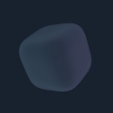
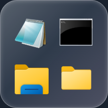
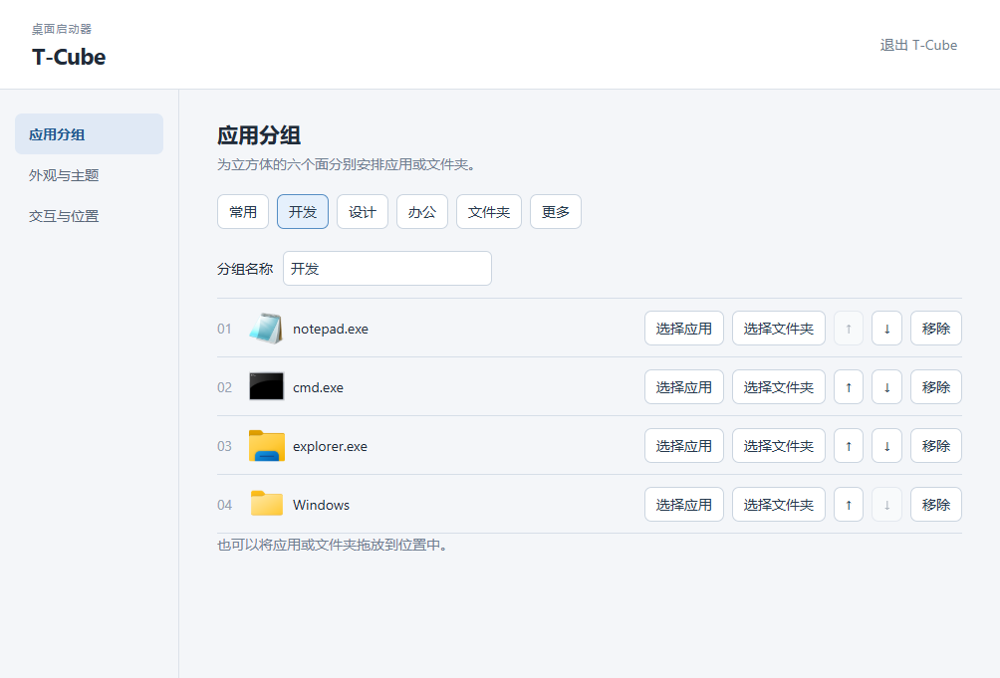
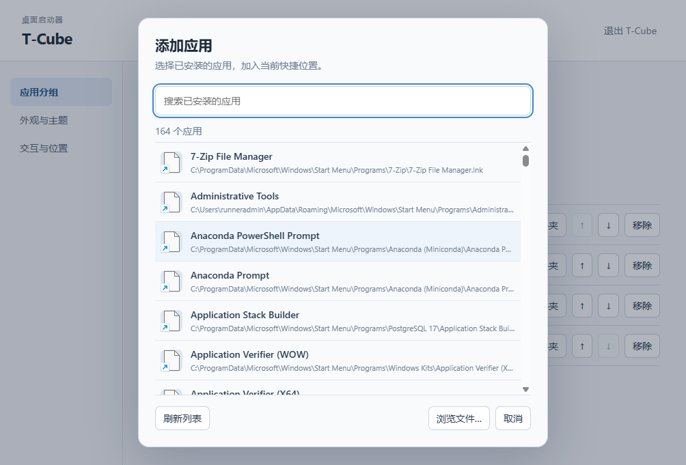

# T-Cube for Windows

Version **0.17.1** targets Windows 10 22H2 / Windows 11, x64. This client uses Electron and Three.js; the repository's macOS client remains native Swift.

## Installer

Download [T-Cube 0.17.1 for Windows x64](https://github.com/gd0306/t-cube/releases/download/v0.17.1/T-Cube-0.17.1-windows-x64-setup.exe) from [Releases](https://github.com/gd0306/t-cube/releases/tag/v0.17.1). It installs per user, includes Electron/native dependencies, creates shortcuts and an uninstall entry, and requires neither Node.js nor administrator privileges. Quit the previous version before updating. Existing `%APPDATA%\\T-Cube` configuration is retained. The installer is not Authenticode signed.

Under **外观与主题 → 材质**, choose **玻璃** or **史莱姆**. All nine themes, custom colors and automatic cycling work with either material. Glass is the default. Slime follows the mouse with lag and elastic rebound while launcher icons remain rigid; Windows animation preferences disable its motion.

## Office tools and idle performance

Open **常用内容** from the tray or `Ctrl+Shift+Space`. Store reusable text and structured fields, group/favorite/search them, and copy or paste whole entries or individual fields. Clipboard capture and dropped text open a draft for review. Paste restores the original input window only while its process identity/focus still match; otherwise text remains copied for manual paste.

**配置与备份** offers validated import/export previews, automatic pre-import backups, manual restore and broken-launcher relinking. Hover delay is configurable and display positions are remembered independently across connection changes. **启动与更新** shows actual login-item state; opt-in authenticated updates require the publisher's signing setup described in [Windows signing and updates](../docs/windows-signing-updates.md).

**性能** offers opt-in idle power saving (off by default on Windows): stationary frames stop rendering until interaction. Disable it to retain 15Hz idle animation; hover/slime interaction runs at 30Hz. Hidden surfaces stop rendering, and idle/hidden native input polling slows down. Glass has deeper tint and contour for visibility on white backgrounds. Theme colors/optical layers blend over 0.4 seconds. Face expansion defaults on; explicit existing preferences are preserved. The cube has no content-library overlay button.

## Preview

Resting size on dark and light backgrounds:

<p></p>

<p></p>



Captured from the installed source client on Windows CI. The transparent widget and expansion are composited over a graphite background for readability. Settings use their actual light background.

## Let a local agent install it

```text
Install T-Cube from https://github.com/gd0306/t-cube (master) on this Windows PC. Read windows/README.md, install Node.js 22 LTS if needed, and run windows/scripts/install.ps1. Quit the old T-Cube first, preserve its configuration, create shortcuts, and launch it. Report any failed checks.
```

中文提示词：

```text
在这台 Windows 上安装 https://github.com/gd0306/t-cube 的 master 分支。按 windows/README.md 准备 Node.js 22 LTS，执行 windows/scripts/install.ps1。先退出旧版、保留配置，创建快捷方式并启动；检查失败时告诉我原因。
```

## Source installation

Install Git and Node.js **22.12 or newer**. Open a new PowerShell terminal after installing prerequisites. Run as your normal user:

```powershell
git clone --branch master https://github.com/gd0306/t-cube.git
cd t-cube
powershell -NoProfile -ExecutionPolicy Bypass -File windows/scripts/install.ps1
```

The execution-policy override applies only to that PowerShell process. The script installs locked dependencies, type-checks, tests, builds, and copies a standalone Electron runtime to `%LOCALAPPDATA%\T-Cube`. It creates desktop and Start menu shortcuts. Administrator privileges are unnecessary. Keep internet access available for the first npm/Electron download.

Quit T-Cube from its tray or settings before updating. Pull `master` and rerun the script. Configuration remains in `%APPDATA%\T-Cube\configuration.json`; removing shortcuts never deletes their targets. To remove the app, quit it and delete the installation directory and shortcuts. Keep the configuration unless you explicitly want a reset.

Optional script flags: `-InstallDirectory <path>`, `-NoLaunch`, `-NoShortcut`. `TCUBE_USER_DATA_DIR` isolates development/test configuration. Development on macOS uses `T-Cube-Windows-Preview`, separate from the native Mac app.

## Controls

Hover to show icons and enlarge; leave to shrink and resume optional idle rotation. Wheel/trackpad scroll turns both axes without snapping (Shift + wheel turns horizontally). Left-button dragging moves and saves the widget position. Hold the right button and drag to rotate the cube along both axes; releasing keeps its angle. Ctrl temporarily restores its resting size; Ctrl + left drag moves it at that size, including when Ctrl is released mid-drag. Right-click without dragging opens settings.

Each of six groups holds four applications or folders. Click **添加应用** to browse installed Windows applications by name and icon, search, then select one to add it to that slot. The list reads Windows application registration, Start Menu shortcuts and App Paths; desktop and registered system/Store apps are supported. **刷新列表** reloads registrations after installations or removals. Use **浏览文件…** for an unregistered portable `.exe` or a shortcut. Folder selection and Explorer drag-and-drop remain available. Choose face expansion (four icons, outside click/Escape to dismiss) or direct icon launching. Nine themes, custom two-color glass, 10/20-second cycling, hover multiplier, idle rotation, resting size and five screen placements are configurable. Tray controls include show/hide, settings, placement and quit.

System-app launch links are kept in `%APPDATA%\T-Cube\applications` alongside configuration. Back up the whole T-Cube data folder when migrating; updates preserve it. Original desktop shortcuts keep their arguments and working directory.

Windows uses its own translucent glass rendering; Apple's Clear Liquid Glass is specific to macOS. Windows animation preferences pause idle motion. Windows 10 and 11 use the same features and configuration schema. Windows ARM64 is outside the initial x64 validation scope.

## Installed applications



The list covers applications registered for the current Windows user, shared Start Menu entries and registered executable paths. Unregistered portable programs can be added through **浏览文件…**. Equivalent launch aliases are deduplicated; distinct arguments or working directories are preserved.

## Development

```powershell
cd windows
npm ci
npm test
npm run typecheck
npm run build
npm start
```

`npm run smoke` launches the real Electron app with a temporary store. CI exercises source installation on Windows runners and saves screenshots/logs. `npm run package:win` builds the x64 NSIS installer after `npm run build`. The **Windows installer** workflow installs that generated package and runs the same smoke checks against its actual installed executable before retaining the installer/checksum artifacts. See the [verification record](../docs/verification/2026-10-27-windows-support.md) for the original port checks and remaining hardware validation.

`src/core/` contains reusable behavior and curved geometry, `src/main/` owns native windows and IPC, `src/native/` wraps Win32 input and shell icons, and `src/renderer/` contains widget/settings UI. The sandboxed preload exposes a narrow typed API; renderers cannot execute shell commands or read arbitrary files.

Shortcut targets also support individual files, HTTP/HTTPS websites and the built-in Windows settings-page catalog. Websites open in the default browser; files use their associated application.
