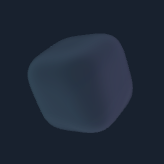
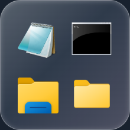
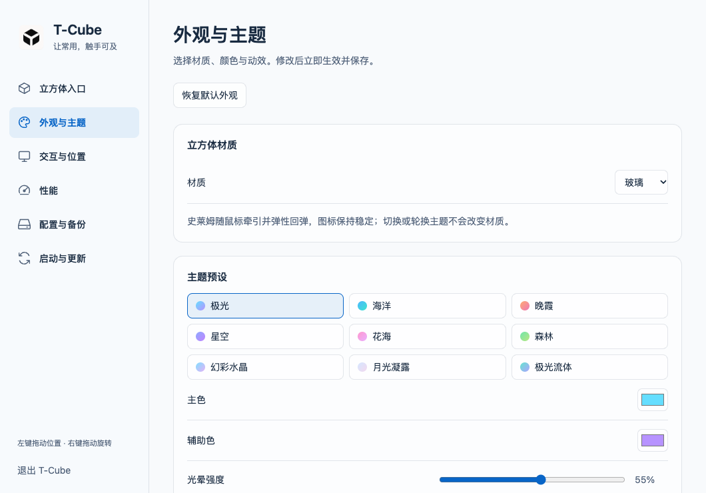
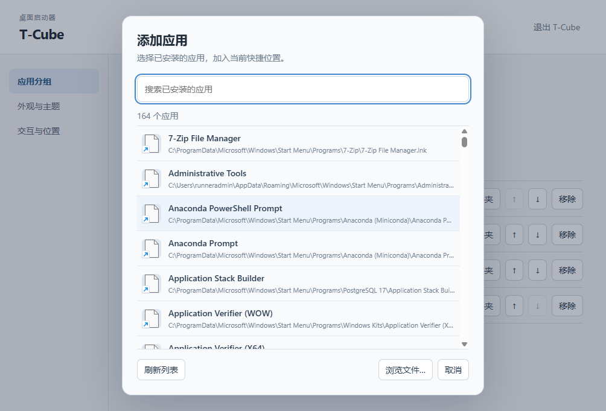

# T-Cube for Windows

Version **0.22.12** targets Windows 10 22H2 / Windows 11, x64. This client uses Electron and Three.js; the repository's macOS client remains native Swift. See the [release verification record](../docs/verification/2026-11-23-0.22.12-release.md).

The Windows interface currently uses Chinese labels. UI names below reproduce those labels, with English descriptions of their purpose.

## Installer

Download [T-Cube 0.22.12 for Windows x64](https://github.com/gd0306/t-cube/releases/download/v0.22.12/T-Cube-0.22.12-windows-x64-setup.exe) from [Releases](https://github.com/gd0306/t-cube/releases/tag/v0.22.12). It installs per user, includes Electron/native dependencies, creates shortcuts and an uninstall entry, and requires neither Node.js nor administrator privileges. Quit the previous version before updating. Existing `%APPDATA%\T-Cube` configuration is retained. The installer is not Authenticode signed.

## Preview

Resting size on dark and light backgrounds:

<p></p>

<p></p>

<picture>
  <source media="(prefers-color-scheme: dark)" srcset="../docs/images/windows-settings-dark.png">
  <source media="(prefers-color-scheme: light)" srcset="../docs/images/windows-settings-light.png">
  
</picture>

Cube and expansion captures come from the installed source client on Windows CI and are composited over a graphite background for readability. The light/dark settings previews use the production renderer with isolated configuration; they demonstrate layout, not native Acrylic on a Windows desktop. See [settings preview and verification](../docs/verification/2026-11-12-settings-release.md).

## Controls

| Input | Result |
| :--- | :--- |
| Hover / leave | Show icons and enlarge / shrink and resume optional idle rotation |
| Wheel or trackpad / Shift + wheel | Rotate both axes without snapping / rotate horizontally |
| Left-button drag | Move the widget and save its position |
| Right-button drag | Rotate freely; release to keep the angle |
| Right-click without dragging | Open settings |
| Hold `Ctrl` over the cube | Temporarily restore resting size; reserve the press for cube controls |
| `Ctrl` + left drag | Move at resting size, including after releasing `Ctrl` mid-drag |
| Hold `Ctrl` alone for 1 second outside the cube | Open clipboard quick list; release, then click a record to copy |
| Click outside / `Esc` | Dismiss the expanded four-icon panel |
| `Ctrl+Shift+Space` | Open reusable content |

Left-click the tray icon to show/hide the cube. Its context menu also offers settings, placement, clipboard history, reusable content, display inputs and quit.

## Cube entries and websites

Each of six faces holds four shortcuts. Open **立方体入口** in settings; each slot offers five entry types:

| Button | Target |
| :--- | :--- |
| **添加应用** | Search installed applications by name and icon |
| **选择文件夹** | Choose a folder |
| **选择文件** | Choose a file, opened with its associated application |
| **添加网站** | Add an HTTP/HTTPS website, opened in the default browser |
| **系统设置** | Choose from the built-in Windows settings-page catalog |

Drag applications, folders or files from Explorer onto a settings slot. The 3D cube accepts plain-text drops to open a reusable-content draft; add file targets through settings.

### Installed applications



The picker reads current-user/shared Start Menu entries, Windows application registration and App Paths; desktop and registered system/Store apps are supported. **刷新列表** reloads registrations after installations or removals. Use **浏览文件…** for an unregistered portable `.exe` or shortcut. Equivalent launch aliases are deduplicated; distinct arguments and working directories are preserved.

System-app launch links are kept in `%APPDATA%\T-Cube\applications` alongside configuration. Back up the whole T-Cube data folder when migrating; updates preserve it. Removing a shortcut never deletes its target.

### Website titles and icons

Website entries show their saved title below the icon on the cube and expanded face. Long titles use single-line ellipsis; hover shows the full name. Clicking the title uses the existing launch/expand preference. Titles include a monochrome outline globe without changing the saved name. Icons are fetched anonymously in the background from the website origin and its declared icon URL, cached for the session and replaced by the existing default artwork on failure. No browser cookies, credentials, saved-page query parameters or third-party favicon service are used; requests, response bytes and raster dimensions are bounded.

## Appearance and desktop controls

Under **外观与主题 → 材质**, choose **玻璃** or **史莱姆**. All nine themes, custom two-color glass and automatic 10/20-second cycling work with either material; colors and optical layers blend over 0.4 seconds. Glass is the default, with tint and contour for visibility on white backgrounds. Slime follows the mouse with lag and elastic rebound while launcher icons remain rigid; Windows animation preferences disable its motion.

Under **交互与位置**, adjust hover multiplier, hover delay, resting size and idle rotation. Use **快速放置** for any screen corner or center; display positions are remembered independently across connection changes. **点击展开面** chooses between a four-icon panel and direct icon launching. Face expansion defaults on, while explicit existing preferences are preserved.

Windows uses its own translucent cube and panel rendering. On macOS, Apple's Clear Liquid Glass is used for the expanded panel. Windows 10 and 11 share the same features and configuration schema; Windows ARM64 is outside the x64 validation scope.

### Edge collapse and fullscreen hiding

Under **交互与位置**, **靠边自动收起** and **全屏应用时隐藏** are independent and default off. A cube within 32 logical pixels of an outer left/right usable screen edge becomes a slim handle after the pointer leaves for about 0.8 seconds; hovering the handle restores it. Shared monitor seams and interior positions stay unchanged. Dragging, face expansion and open settings protect it from collapse. Fullscreen hiding uses public window metadata on the cube's display, requires no screen capture permission, and preserves manual tray hiding. Collapsed geometry is never saved.

The collapsed handle follows the OS light/dark appearance: a white frosted capsule by day and dark sky-black glass by night, with a subtle 8.4-second internal shimmer while visible. Windows uses a frosted style rather than desktop backdrop blur. Reduced motion, reduced transparency and forced colors use a static fallback; hidden handles cancel their CSS animation and compositor hints.

Windows may impose a wider transparent native window at some display scales; its drawing and input region are clipped to the same 10 × 56 logical-pixel handle, with the unused container passing input through.

## Clipboard and reusable content

### Session clipboard history

Open history from the tray menu or the content window's **剪贴板历史** tab. Every launch starts recording automatically without importing existing clipboard content. Pause recording for the current session; enabling or resuming starts with the next copy, while existing history stays available. File drops and supported private/history exclusion markers are skipped, but unmarked sensitive content may still be recorded. History stays in memory, is cleared on exit, is excluded from configuration and backups, and has no cloud sync.

Text and image tabs are separate:

- Text retains up to 100 entries, with 64 KiB UTF-8 per entry and 2 MiB total. Search or select records to preview a merge in list order, optionally trimming each line and collapsing repeated blank lines. Copy, paste or explicitly save the preview as ordinary content; originals stay unchanged. Merges are limited to 64 KiB UTF-8.
- Images retain up to 10 entries, with 8 MiB per normalized PNG, 32 MiB total and 16 megapixels per image. PNG/JPEG representations normalize to PNG. Preview, copy, focus-checked paste and delete are supported, without OCR or automatic content conversion. Clearing history releases the stored records.

Paste restores only the captured input target while its process identity and focus still match. Unsupported or unavailable targets leave the text or image copied for manual paste.

<details>
<summary>Image processing and memory bounds</summary>

Only compressed bytes and small thumbnails are retained; selected previews are bounded. A single sandboxed canvas processor performs codecs away from the Electron main thread, keeps at most one active job plus the newest pending recording and preview, and exits after 10 seconds idle or immediately on pause/clear/quit. Native DIB headers are checked before Electron materializes image bytes (16 megapixels, 65 MiB raw bound); native conversion and one active decoder can still hold a temporary uncompressed bitmap. Clear and quit release all history.

</details>

### Quick clipboard panel

Hold `Ctrl` alone for **1 second** outside the cube to open a compact history list beside the pointer. Release `Ctrl`, then click a text or image entry once to copy and dismiss it. **编辑文字** opens a session draft with explicit **保存** / **取消**; deletion is available for both text and images. Editing preserves the entry ID, timestamp and order, does not write the system clipboard, and rejects changes exceeding the text limits without removing other entries. The quick list offers **启用记录** while paused.

Start the hold outside the cube. Starting on or entering the cube, an active cube drag, another key, a mouse button or wheel input cancels history for that whole press; release `Ctrl` before trying again. Pointer movement outside the cube does not cancel. Each press opens the list at most once. Cube resizing, `Ctrl`-drag and existing `Ctrl` shortcuts retain priority. Startup with `Ctrl` already down and sleep/resume require a fresh release. Raw Input observes interruptions and pointer context without a global keyboard hook, key logging or an extra permission prompt. If registration is unavailable, open full history from the tray.

The quick window follows system light/dark appearance and uses native Acrylic on Windows 11 22H2+. Windows 10, older Windows 11, reduced-transparency and high-contrast modes use a solid tinted fallback. Drag its title to move it; every fresh invocation returns to the history list without restoring unsaved previews. `Esc`, the close button or clicking another window dismisses the list; an unsaved draft stays available until cancelled or the app exits.

### Per-entry text tools

Open a text record's processing menu to preview plain text, whitespace cleanup, case conversion, lossless JSON formatting/minification or URL component encoding/decoding. Copy directly, or edit the preview before copying or explicitly saving to that session entry. Processing stays local and previews do not overwrite history. See [preview and verification](../docs/verification/2026-11-13-clipboard-text-tools.md).

### Reusable content and templates

Open **常用内容** from the tray or `Ctrl+Shift+Space`. Store reusable text and structured fields, group/favorite/search them, and copy or paste whole entries or individual fields. Template mode substitutes named placeholders after you fill variables and preview the result. Clipboard capture and dropped text open a draft for review. Paste uses the same focus checks described above.

## Settings, backup and startup

Settings use a persistent sidebar with six pages:

| UI label | Purpose |
| :--- | :--- |
| **立方体入口** | Six faces and their launcher slots |
| **外观与主题** | Material, colors, optical effects and theme cycling |
| **交互与位置** | Hover, size, rotation, face expansion and desktop placement |
| **性能** | Idle power saving |
| **配置与备份** | Import, export, restore and launcher repair |
| **启动与更新** | Login startup and release checks |

Changes save immediately. **恢复默认外观** resets only material, colors, optical effects and theme cycling, preserving launchers and interaction settings. Settings follow system light/dark appearance and use native Acrylic on Windows 11 22H2+; older systems, reduced-transparency and high-contrast modes use a solid fallback. The tray icon is a blue/cyan three-face cube with a contrasting outline and multi-resolution ICO artwork.

### Configuration and backup

**配置与备份** offers validated import/export previews, automatic pre-import backups, manual restore and broken-launcher relinking. Configuration remains in `%APPDATA%\T-Cube\configuration.json`; session clipboard history is excluded. Display-input mappings have their own file and are excluded from launcher exports, as described below.

### Login startup and updates

**启动与更新** shows actual login-item state. An installed copy enables launch at login on its first run; an explicit opt-out is saved and later launches never force it back on. Windows startup restrictions are respected and registration failures appear here. Both the NSIS installer and source installer apply this default through the app on first launch.

Unsigned installers offer manual checks and opt-in six-hour release reminders, defaulting to off. These anonymously read GitHub metadata, remember notified versions and open the release page for manual installation. No signing credentials or token are required. Authenticated in-app installation requires the publisher's signing setup described in [Windows signing and updates](../docs/windows-signing-updates.md).

## Performance and power saving

Under **性能**, idle power saving is opt-in and **off by default on Windows**: enable it to stop stationary frames until interaction. Disable it to retain 15 Hz idle animation; hover/slime interaction runs at 30 Hz. Hidden surfaces stop rendering, and idle/hidden native input polling slows down.

## Display input switching

Open **显示器输入源…** from the tray context menu; left-click still shows or hides the cube. The panel switches a DDC/CI-capable monitor between **Type-C** on the left and **HDMI** on the right through a two-segment switch. Click a port or use the keyboard arrow keys; controls lock while busy, retain the last confirmed selection during a request, and clear selection when readback is unknown. Opening or refreshing reads hardware; there is no background display polling, startup source restoration, volume control or network relay.

The input panel automatically enumerates connected displays without model-specific presets; previously saved mappings remain unchanged. Monitors that relied on the automatic preset without a saved mapping need calibration once. Select the intended monitor by name and its `DISPLAY` number. Targets with ambiguous identity, missing physical DDC transport, or unavailable input readback remain visible with switching disabled. Detection refreshes on display changes and panel reopen; a disconnected selection does not silently move to another monitor.

Open **如何获取输入代码？** in the input panel for the full procedure. Enable DDC/CI in the monitor’s physical menu if offered, connect and wake both hosts, then physically select Type-C. On the host now shown, select that monitor in T-Cube and click **刷新**; expand **设置输入源代码** and record **当前代码**. Physically select the intended HDMI port and repeat on its active host. Save the two distinct decimal values in `0–65535` on each host separately. Saving only stores the mapping; it sends no switch command. The app reads current input via VCP `0x60` (a feature number, not a port value) and does not discover all supported input values. A non-continuous VCP's reported maximum is not a valid code range.

To verify, ensure the physical menu is available for recovery, activate one mapped port, and click the other once. Check the picture and refresh on the now-active host. Lost readback means unconfirmed, even if the monitor switched. If codes remain unavailable, check DDC/CI and graphics drivers, try a direct connection instead of a dock/KVM/adapter, and refresh; these are diagnostic steps, not compatibility guarantees. Use the physical input menu when VCP `0x60` is unavailable. [Source verification and UI captures](../docs/verification/2026-11-07-display-input-discovery.md).

A monitor may stop responding on an inactive connection after switching. An accepted command followed by lost readback is shown as unconfirmed, with no automatic retry or reversal. Switch back from T-Cube on the currently active computer, or use the monitor's physical input menu. Compatibility depends on the monitor firmware, graphics driver and cable/adapter path; the software cannot guarantee control over inactive inputs.

Mappings live separately at `%APPDATA%\T-Cube\display-inputs.json` and are not included in the existing launcher configuration export. Invalid existing files remain intact and block replacement; back up and repair the file, then fully quit and restart T-Cube before refreshing the panel or saving calibration again. Native display operations execute away from Electron's main process and renderer. Only the input panel's own main frame can invoke its narrow IPC; other windows receive no display-control privilege.

## Source installation

Install Git and Node.js **22.12 or newer**. Open a new PowerShell terminal after installing prerequisites. Run as your normal user:

```powershell
git clone --branch master https://github.com/gd0306/t-cube.git
cd t-cube
powershell -NoProfile -ExecutionPolicy Bypass -File windows/scripts/install.ps1
```

The execution-policy override applies only to that PowerShell process. The script installs locked dependencies, type-checks, tests, builds, and copies a standalone Electron runtime to `%LOCALAPPDATA%\T-Cube`. It creates desktop and Start menu shortcuts. Administrator privileges are unnecessary. Keep internet access available for the first npm/Electron download.

Quit T-Cube from its tray or settings before updating. Pull `master` and rerun the script. Configuration remains in `%APPDATA%\T-Cube\configuration.json`; removing shortcuts never deletes their targets. To remove the app, quit it and delete the installation directory and shortcuts. Keep the configuration unless you explicitly want a reset.

Optional script flags: `-InstallDirectory <path>`, `-NoLaunch`, `-NoShortcut`. `TCUBE_USER_DATA_DIR` isolates development/test configuration. Development on macOS uses `T-Cube-Windows-Preview`, separate from the native Mac app.

## Let a local agent install it

```text
Install T-Cube from https://github.com/gd0306/t-cube (master) on this Windows PC. Read windows/README.md, install Node.js 22 LTS if needed, and run windows/scripts/install.ps1. Quit the old T-Cube first, preserve its configuration, create shortcuts, and launch it. Report any failed checks.
```

中文提示词：

```text
在这台 Windows 上安装 https://github.com/gd0306/t-cube 的 master 分支。按 windows/README.md 准备 Node.js 22 LTS，执行 windows/scripts/install.ps1。先退出旧版、保留配置，创建快捷方式并启动；检查失败时告诉我原因。
```

## Development and verification

Use Node.js **22.12 or newer**. From the repository root, install the locked dependencies (including Electron and Playwright) before running these commands. The first download requires internet access; `npm start` opens the app in a desktop session.

```powershell
cd windows
npm ci
npm test
npm run typecheck
npm run build
npm start
```

### Electron and installed-app smoke checks

After `npm ci` and `npm run build`, run smoke checks in a logged-in **Windows desktop session** for native input coverage. Playwright controls the downloaded Electron runtime; this command does not require a separate Chromium browser installation. The test uses a temporary configuration store and owned clipboard/receiver checks. On macOS it is a preview and skips Windows native input helpers.

```powershell
npm run smoke

# Build the x64 NSIS installer after npm run build
npm run package:win
```

CI exercises source installation on Windows runners and saves screenshots/logs. The **Windows installer** workflow installs the generated NSIS package and runs smoke checks against its actual installed executable before retaining installer/checksum artifacts. See the [original port verification](../docs/verification/2026-10-27-windows-support.md) for the initial checks and hardware limits.

Windows smoke includes `scripts/clipboard-quick-smoke.ts`, using real `SendInput` in its owned receiver and clipboard snapshot: short `Ctrl`, outside hold, hover-size arbitration, whole-press cancellation, release retention, editing, copy/dismiss and self-recording suppression. This is automated desktop input. Raw Input delivery, native Acrylic, accessibility preferences and physical `Ctrl`/drag/shortcut behavior still require Windows desktop verification.

### Isolated clipboard UI checks

Run from `windows/` after `npm ci` and `npm run build`. The two renderer checks require Playwright Chromium; install it first as shown below. Alternatively, set `TCUBE_CHROME_EXECUTABLE` to an installed Chromium browser. On macOS the renderer scripts default to `/Applications/Google Chrome.app/Contents/MacOS/Google Chrome`; set that variable to the installed Playwright Chromium executable if Chrome is unavailable. The Electron host check uses Electron directly and requires a desktop session.

```powershell
npx playwright install chromium
npx tsx scripts/clipboard-quick-ui.ts
npx tsx scripts/desktop-clipboard-ui.ts
npx tsx scripts/clipboard-quick-electron.ts
```

The quick-list renderer check covers enable, edit/save/cancel, rejected edits, copy, image deletion and failure recovery against an owned in-memory recorder. The history-manager check covers the full history UI. The Electron host check covers real window/IPC lifecycle with an isolated configuration and never reads or writes the system clipboard. macOS runs are previews and do not validate Win32 behavior.

### Source layout and platform references

- `src/core/`: reusable TypeScript behavior and curved geometry.
- `src/main/`: native windows, persistence and IPC.
- `src/native/`: Win32 input and shell icons.
- `src/renderer/`: widget and settings UI.

The sandboxed preload exposes a narrow typed API; renderers cannot execute shell commands or read arbitrary files. Material/version behavior follows [Electron's window API](https://www.electronjs.org/docs/latest/api/browser-window/#winsetbackgroundmaterialmaterial-windows). Raw Input uses [Microsoft's background-input registration](https://learn.microsoft.com/en-us/windows/win32/inputdev/using-raw-input), without disabling legacy input messages.
