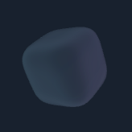
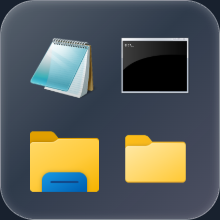
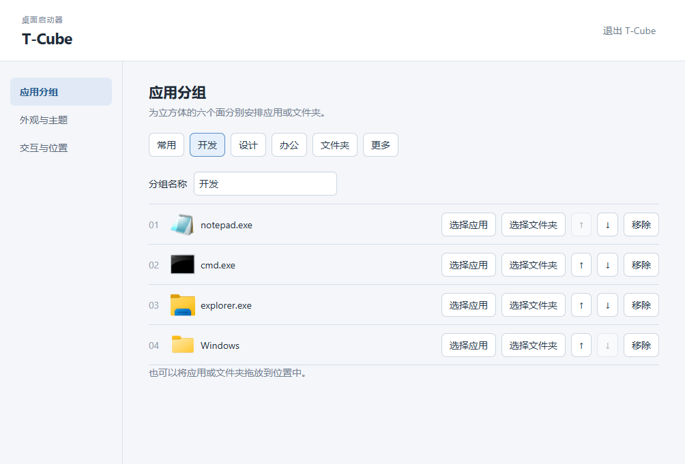
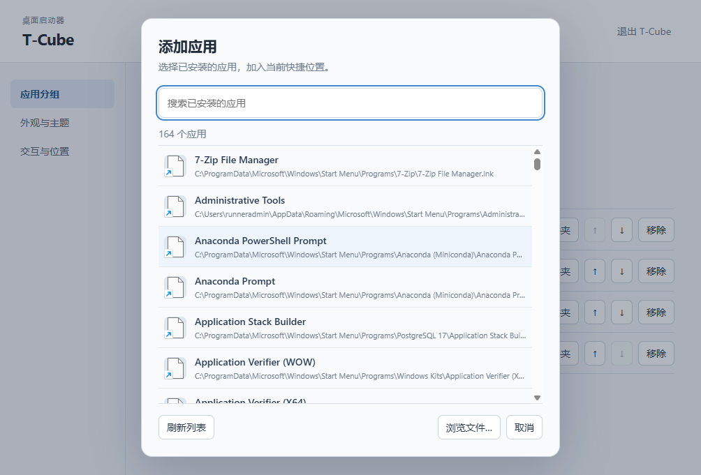

# T-Cube for Windows

Version **0.22.2** targets Windows 10 22H2 / Windows 11, x64. This client uses Electron and Three.js; the repository's macOS client remains native Swift.

## Installer

Download [T-Cube 0.22.2 for Windows x64](https://github.com/gd0306/t-cube/releases/download/v0.22.2/T-Cube-0.22.2-windows-x64-setup.exe) from [Releases](https://github.com/gd0306/t-cube/releases/tag/v0.22.2). It installs per user, includes Electron/native dependencies, creates shortcuts and an uninstall entry, and requires neither Node.js nor administrator privileges. Quit the previous version before updating. Existing `%APPDATA%\\T-Cube` configuration is retained. The installer is not Authenticode signed.

Under **外观与主题 → 材质**, choose **玻璃** or **史莱姆**. All nine themes, custom colors and automatic cycling work with either material. Glass is the default. Slime follows the mouse with lag and elastic rebound while launcher icons remain rigid; Windows animation preferences disable its motion.

Under **交互与位置**, **靠边自动收起** and **全屏应用时隐藏** are independent and default off. A cube within 32 logical pixels of an outer left/right usable screen edge becomes a slim handle after the pointer leaves for about 0.8 seconds; hovering the handle restores it. Shared monitor seams and interior positions stay unchanged. Dragging, face expansion and open settings protect it from collapse. Fullscreen hiding uses public public window metadata on the cube's display, requires no screen capture permission, and preserves manual tray hiding. Collapsed geometry is never saved. The collapsed handle follows the OS light/dark appearance: a white frosted capsule by day and dark sky-black glass by night, with a subtle 8.4-second internal shimmer while visible. Windows uses a frosted style rather than desktop backdrop blur. Reduced motion, reduced transparency and forced colors use a static fallback; hidden handles cancel their CSS animation and compositor hints. Windows may impose a wider transparent native window at some display scales; its drawing and input region are clipped to the same 10 × 56 logical-pixel handle, with the unused container passing input through.


## Display input switching

Version `0.22.0` adds **显示器输入源…** to the tray context menu; left-click still shows or hides the cube. The panel switches a DDC/CI-capable monitor between **Type-C** on the left and **HDMI** on the right when the slider commits. Opening or refreshing reads hardware; there is no background display polling, startup source restoration, volume control or network relay.

Choose the correct monitor, then open input calibration if its ports are not recognized. The current raw number helps identify the active port. Save two different decimal values in `0–65535`; the other port's value may need to be read on its active computer. Saving calibration never switches the monitor. An exact EDID model match can select the validated **27C1U-D** profile automatically; otherwise choose that preset explicitly only for the matching model. Its measured values are **Type-C `7` / HDMI `5`**, rather than the advertised HDMI value `17`. User mappings override the preset and are bound to full monitor-interface identity, with ambiguous cloned targets rejected.

A monitor may stop responding on an inactive connection after switching. An accepted command followed by lost readback is shown as unconfirmed, with no automatic retry or reversal. Switch back from T-Cube on the currently active computer, or use the monitor's physical input menu. Compatibility depends on the monitor firmware, graphics driver and cable/adapter path; the software cannot guarantee control over inactive inputs.

Mappings live separately at `%APPDATA%\T-Cube\display-inputs.json` and are not included in the existing launcher configuration export. Invalid existing files remain intact and block replacement; back up and repair the file, then fully quit and restart T-Cube before refreshing the panel or saving calibration again. Native display operations execute away from Electron's main process and renderer. Only the input panel's own main frame can invoke its narrow IPC; other windows receive no display-control privilege.

## Office tools and idle performance

Website entries show their saved title below the icon on the cube and expanded face. Long titles use single-line ellipsis; hover shows the full name. Clicking the title uses the existing launch/expand preference. Rendering stays local with no favicon requests.

Clipboard history is available from the tray or the **剪贴板历史** tab. It starts paused on every launch; choose **启用记录**, then make a new plain-text copy. Search, delete, clear, copy, focus-checked paste and explicitly save a common-content draft. Records stay in memory and disappear on exit; they are excluded from backup/export. Limits are 100 items, 64 KiB UTF-8 per item and 2 MiB text total. File drops and supported exclusion markers are skipped, but unmarked sensitive text may still be recorded. No image history or cloud sync.

Open **常用内容** from the tray or `Ctrl+Shift+Space`. Store reusable text and structured fields, group/favorite/search them, and copy or paste whole entries or individual fields. Clipboard capture and dropped text open a draft for review. Paste restores the original input window only while its process identity/focus still match; otherwise text remains copied for manual paste.

**剪贴板历史** is session-only and defaults off. Enabling or resuming starts with the next copy. Text and image tabs are separate: text retains up to 100 entries (64 KiB each, 2 MiB total), while images retain up to 10 (8 MiB normalized PNG each, 32 MiB total, 16 megapixels). PNG/JPEG clipboard representations normalize to PNG in main; file drops and supported private/history exclusion markers are skipped. Only compressed bytes and small thumbnails are retained; selected previews are bounded. A single sandboxed canvas processor performs codecs away from the Electron main thread, keeps at most one active job plus the newest pending recording and preview, and exits after 10 seconds idle or immediately on pause/clear/quit. Native DIB headers are checked before Electron materializes image bytes (16 megapixels, 65 MiB raw bound); native conversion and one active decoder can still hold a temporary uncompressed bitmap. Clear and quit release all history; it is excluded from configuration and backups.

Select text checkboxes to preview a merge in current list order, optionally trim each line and collapse repeated blank lines. Copy, paste or explicitly save the preview as ordinary content; original entries are unchanged. Merges are limited to 64 KiB UTF-8. Images support preview, copy, focus-checked paste and delete, with no OCR or automatic content conversion. Paste restores only the captured input target; unsupported or unavailable targets leave the copy available for manual paste.

**配置与备份** offers validated import/export previews, automatic pre-import backups, manual restore and broken-launcher relinking. Hover delay is configurable and display positions are remembered independently across connection changes. **启动与更新** shows actual login-item state; unsigned installers offer manual checks and opt-in six-hour release reminders, defaulting to off. These anonymously read GitHub metadata, remember notified versions and open the release page for manual installation. No signing credentials or token are required. Authenticated in-app installation requires the publisher's signing setup described in [Windows signing and updates](../docs/windows-signing-updates.md).

**性能** offers opt-in idle power saving (off by default on Windows): stationary frames stop rendering until interaction. Disable it to retain 15Hz idle animation; hover/slime interaction runs at 30Hz. Hidden surfaces stop rendering, and idle/hidden native input polling slows down. Glass has deeper tint and contour for visibility on white backgrounds. Theme colors/optical layers blend over 0.4 seconds. Face expansion defaults on; explicit existing preferences are preserved. The cube has no content-library overlay button.

## Preview

Resting size on dark and light backgrounds:

<p></p>

<p></p>



Captured from the installed source client on Windows CI. The transparent widget and expansion are composited over a graphite background for readability. Settings use their actual light background.

## Let a local agent install it

```text
Install T-Cube from https://github.com/gd0306/t-cube (master) on this Windows PC. Read windows/README.md, install Node.js 22 LTS if needed, and run windows/scripts/install.ps1. Quit the old T-Cube first, preserve its configuration, create shortcuts, and launch it. Report any failed checks.
```

中文提示词：

```text
在这台 Windows 上安装 https://github.com/gd0306/t-cube 的 master 分支。按 windows/README.md 准备 Node.js 22 LTS，执行 windows/scripts/install.ps1。先退出旧版、保留配置，创建快捷方式并启动；检查失败时告诉我原因。
```

## Source installation

Install Git and Node.js **22.12 or newer**. Open a new PowerShell terminal after installing prerequisites. Run as your normal user:

```powershell
git clone --branch master https://github.com/gd0306/t-cube.git
cd t-cube
powershell -NoProfile -ExecutionPolicy Bypass -File windows/scripts/install.ps1
```

The execution-policy override applies only to that PowerShell process. The script installs locked dependencies, type-checks, tests, builds, and copies a standalone Electron runtime to `%LOCALAPPDATA%\T-Cube`. It creates desktop and Start menu shortcuts. Administrator privileges are unnecessary. Keep internet access available for the first npm/Electron download.

Quit T-Cube from its tray or settings before updating. Pull `master` and rerun the script. Configuration remains in `%APPDATA%\T-Cube\configuration.json`; removing shortcuts never deletes their targets. To remove the app, quit it and delete the installation directory and shortcuts. Keep the configuration unless you explicitly want a reset.

Optional script flags: `-InstallDirectory <path>`, `-NoLaunch`, `-NoShortcut`. `TCUBE_USER_DATA_DIR` isolates development/test configuration. Development on macOS uses `T-Cube-Windows-Preview`, separate from the native Mac app.

## Controls

Hover to show icons and enlarge; leave to shrink and resume optional idle rotation. Wheel/trackpad scroll turns both axes without snapping (Shift + wheel turns horizontally). Left-button dragging moves and saves the widget position. Hold the right button and drag to rotate the cube along both axes; releasing keeps its angle. Ctrl temporarily restores its resting size; Ctrl + left drag moves it at that size, including when Ctrl is released mid-drag. Right-click without dragging opens settings.

Each of six groups holds four applications or folders. Click **添加应用** to browse installed Windows applications by name and icon, search, then select one to add it to that slot. The list reads Windows application registration, Start Menu shortcuts and App Paths; desktop and registered system/Store apps are supported. **刷新列表** reloads registrations after installations or removals. Use **浏览文件…** for an unregistered portable `.exe` or a shortcut. Folder selection and Explorer drag-and-drop remain available. Choose face expansion (four icons, outside click/Escape to dismiss) or direct icon launching. Nine themes, custom two-color glass, 10/20-second cycling, hover multiplier, idle rotation, resting size and five screen placements are configurable. Tray controls include show/hide, settings, placement and quit.

System-app launch links are kept in `%APPDATA%\T-Cube\applications` alongside configuration. Back up the whole T-Cube data folder when migrating; updates preserve it. Original desktop shortcuts keep their arguments and working directory.

Windows uses its own translucent glass rendering; Apple's Clear Liquid Glass is specific to macOS. Windows animation preferences pause idle motion. Windows 10 and 11 use the same features and configuration schema. Windows ARM64 is outside the initial x64 validation scope.

## Installed applications



The list covers applications registered for the current Windows user, shared Start Menu entries and registered executable paths. Unregistered portable programs can be added through **浏览文件…**. Equivalent launch aliases are deduplicated; distinct arguments or working directories are preserved.

## Development

```powershell
cd windows
npm ci
npm test
npm run typecheck
npm run build
npm start
```

`npm run smoke` launches the real Electron app with a temporary store. CI exercises source installation on Windows runners and saves screenshots/logs. `npm run package:win` builds the x64 NSIS installer after `npm run build`. The **Windows installer** workflow installs that generated package and runs the same smoke checks against its actual installed executable before retaining the installer/checksum artifacts. See the [verification record](../docs/verification/2026-10-27-windows-support.md) for the original port checks and remaining hardware validation.

`src/core/` contains reusable behavior and curved geometry, `src/main/` owns native windows and IPC, `src/native/` wraps Win32 input and shell icons, and `src/renderer/` contains widget/settings UI. The sandboxed preload exposes a narrow typed API; renderers cannot execute shell commands or read arbitrary files.

Shortcut targets also support individual files, HTTP/HTTPS websites and the built-in Windows settings-page catalog. Websites open in the default browser; files use their associated application.
